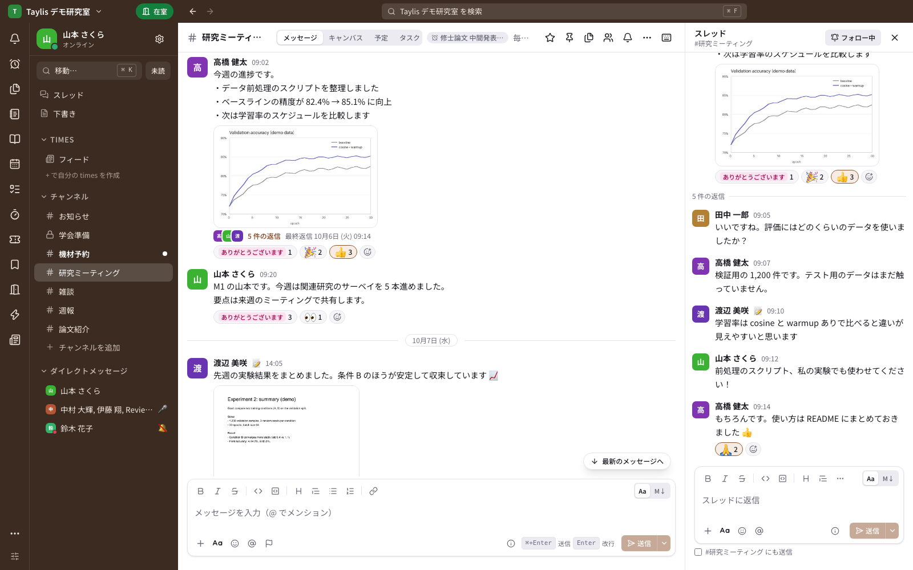
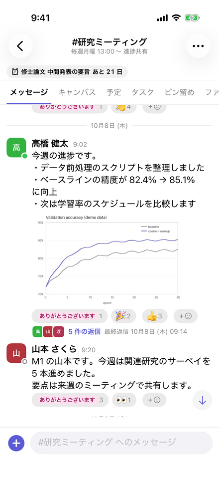
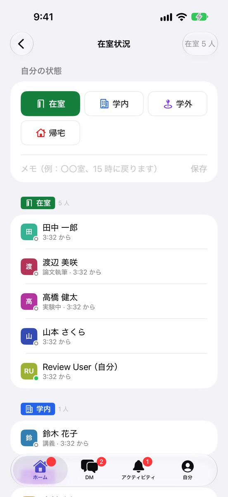
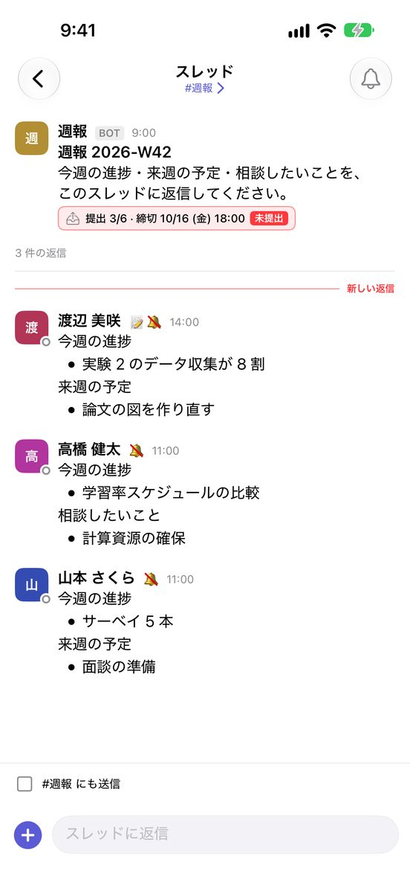
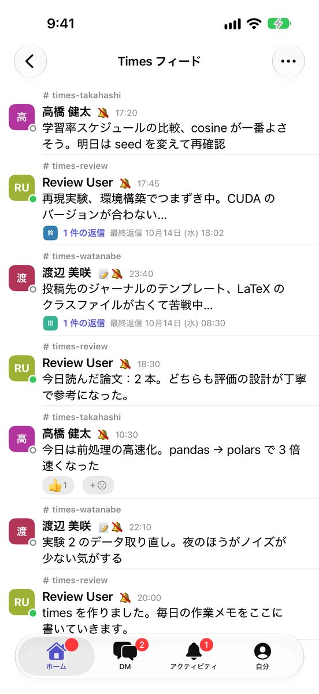
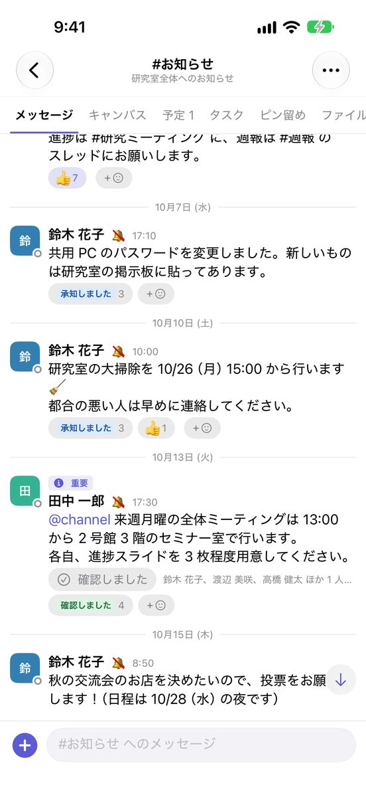
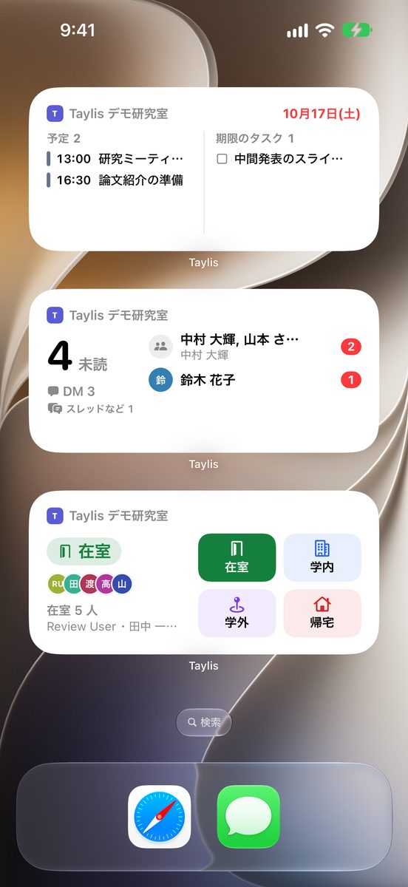

# Taylis

[English](README.md)

Taylis（テイリス）は、大学の研究室のためのセルフホスト型ワークスペースです。研究室が自分たちでサーバを用意して
動かし、Windows・macOS・iOS・Android のアプリと、ブラウザから使います。チャンネル・スレッド・DM に加えて、
在室状況、週報の提出管理、学生の作業メモ（Times）、確認ボタン付きのお知らせ、締切・タスク・カレンダーなど、
研究室で毎日使う道具をひとつにまとめています。

**ドキュメント：<https://kanotown.github.io/taylis/>**（使い方ガイド・管理者ガイド・サーバの立て方・仕組み）。
サイトの原稿は [website/](website/) にあります。

（旧名は「ChikuwaChat」です。バンドル ID・パッケージ名・`chikuwachat://` の URL スキームなど、内部の識別子には古い名前が残っています。）

> **サポートの保証はありません。** Taylis は作者が自分たちで使うために開発し、そのままの形で公開しています。
> Issue やプルリクエストは歓迎しますが、対応・修正・今後の予定はお約束できません。[CONTRIBUTING.md](CONTRIBUTING.md) をご覧ください。

<p>
  
  
</p>

## 主な機能

研究室のための機能：

- 在室状況：在室・学内・学外・帰宅をワンタップで。誰が研究室にいるかひと目でわかり、ホーム画面のウィジェットからも
  変えられます
- 週報：毎週スレッドが立ち、締切までに誰が提出したかがわかります
- Times：学生ごとの作業メモのチャンネルを、ひとつのフィードで読めます。指導教員は自動でフォローします
- 確認依頼：大事なお知らせに確認ボタンを付け、まだ読んでいない人がわかります
- 締切のカウントダウン、タスク、繰り返しの予定と iCal に対応したカレンダー（チャンネルの予定は追加をチャンネルに
  知らせます）
- 共有の機材やソフトウェアの順番待ち（予約）
- 学年・指導教員つきの名簿（`@m1` のようなメンション）
- ホーム画面のウィジェット（iOS・Android）：在室状況、未読・メンション、今日の予定・締切

| 在室状況 | 週報 | Times（作業メモ） | 確認依頼 | ホーム画面のウィジェット |
| :---: | :---: | :---: | :---: | :---: |
|  |  |  |  |  |

チャットとワークスペース：

- 公開・非公開のチャンネル、DM、グループ DM
- スレッド、リアクション、メンション、編集と削除。未読の位置は端末の間で同期します
- 確実な配送：サーバでの順序付け、再送しても重複しない送信、再接続後の取りこぼしの回収（WebSocket + REST、
  [docs/SYNC_PROTOCOL.md](docs/SYNC_PROTOCOL.md)）
- APNs（iOS）と FCM（Android）によるプッシュ通知。トランザクショナル・アウトボックスから送ります
- 日本語と英語の全文検索（PostgreSQL + PGroonga）
- S3 互換のオブジェクトストレージへのファイル添付（標準は versitygw）
- Canvas（共有の文書）、ドキュメント（Wiki）、ワークフロー、カスタム絵文字とスタンプ
- Google でのログイン（組織のドメインに限定できます）、招待、ゲスト
- 1 つのアプリで複数のサーバを切り替え
- Mattermost と Slack のエクスポートの取り込み
- 必要に応じて AI のボット（メンションへの返答、要約、過去のメッセージへの質問。[docs/AI.md](docs/AI.md)）
- バックアップと復元のスクリプト、リリースのタグからの自動デプロイ

## 構成

モジュラーモノリスです。**FastAPI**（Python）+ **PostgreSQL** と **PGroonga** + **versitygw**（S3 互換の
オブジェクトストレージ）を Docker Compose で動かし、Caddy（または既存のリバースプロキシ）の後ろに置きます。
Redis・Kafka・Kubernetes は使いません。詳しくは [docs/ARCHITECTURE.md](docs/ARCHITECTURE.md) をご覧ください。

## サーバを立てる

Docker Engine と compose プラグインの入った Linux サーバ（2 vCPU / メモリ 4 GB 以上）と、そのサーバを指す
ドメイン名（ポート 80 と 443 を開けたもの）が必要です。

```sh
git clone https://github.com/kanotown/taylis.git /srv/chikuwachat
cd /srv/chikuwachat/infra
cp .env.example .env && chmod 600 .env     # SECRET_KEY, POSTGRES_PASSWORD, S3_SECRET_KEY, CHAT_DOMAIN を設定
docker compose -f docker-compose.yml -f docker-compose.prod.yml --profile proxy up -d --build
docker compose -f docker-compose.yml -f docker-compose.prod.yml exec app python -m app.cli create-admin --username admin
```

ブラウザで `https://<CHAT_DOMAIN>/` を開くか、デスクトップやスマートフォンのアプリにその URL を入れてください。
バックアップと復元、プッシュ通知（APNs / FCM）の設定、既存のリバースプロキシの後ろでの運用、自動デプロイ、
取り込みについては [infra/README.md](infra/README.md) に書いてあります。

まず架空のデータで試すなら、[infra/demo/README.md](infra/demo/README.md) の手順で手元にデモのワークスペース
（「Taylis デモ研究室」、`python -m app.cli seed-demo`）を立てられます。

## アプリ

| アプリ | 技術 | 備考 |
| --- | --- | --- |
| ブラウザ | React（サーバが配信） | `https://<CHAT_DOMAIN>/` |
| デスクトップ | Tauri 2 + React | Windows と macOS。公式のリリースからアプリ内で更新 |
| iOS | SwiftUI | APNs でプッシュ。Xcode でビルド（[docs/DEVELOPMENT.md](docs/DEVELOPMENT.md)） |
| Android | Jetpack Compose | FCM でプッシュ。Gradle でビルド |

どのアプリも、同じ API（[openapi/openapi.json](openapi/openapi.json)）でサーバとやり取りします。

## 開発

- [docs/DEVELOPMENT.md](docs/DEVELOPMENT.md)：開発環境、チェックのコマンド、フォークでのビルド
- [docs/IMPLEMENTATION_PLAN.md](docs/IMPLEMENTATION_PLAN.md)：マイルストーン。残りは [docs/BACKLOG.md](docs/BACKLOG.md)
- 設計の文書は、ほとんど日本語で `docs/` にあります

**管理者に見えるもの**：メンバーでない管理者は、アプリから非公開チャンネルや DM を読めません。ただし、サーバ・
データベース・バックアップにアクセスできる人は、技術的にはすべてのメッセージを読めます。利用者にそのことを伝え、
管理者やサーバの担当を誰にするかを考えてください（[docs/LAB.md](docs/LAB.md) J）。

## セキュリティ

脆弱性は、公開の場ではなく非公開で報告してください。[SECURITY.md](SECURITY.md) をご覧ください。

## ライセンス

ソースコードは [Apache License 2.0](LICENSE) です。同梱している第三者のデータは
[THIRD_PARTY_NOTICES.md](THIRD_PARTY_NOTICES.md) にまとめています。

「Taylis」の名前とリスのアイコン・ロゴは、Apache License の対象**外**です。フォークでは別の名前とアイコンを
使ってください。[TRADEMARKS.md](TRADEMARKS.md) と [NOTICE](NOTICE) をご覧ください。
