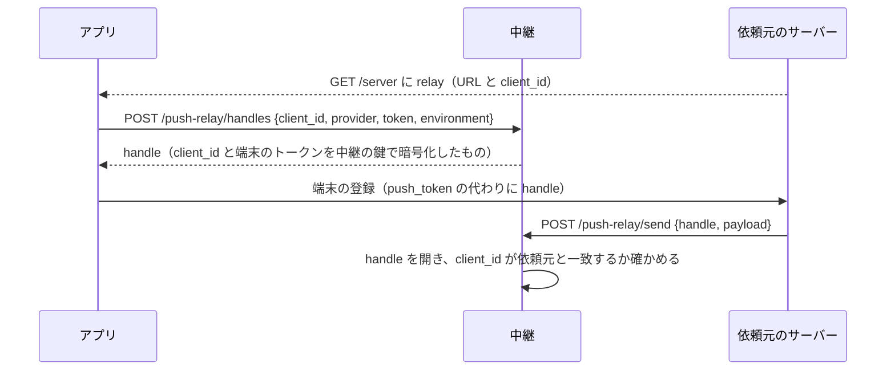

# プッシュの中継（PUSH_RELAY）

APNs と FCM は、**アプリを配っている人の鍵** で署名したプッシュしか受け付けない。鍵を持たない Taylis サーバー
（セルフホストのサーバー、同じ研究室の 2 台目のサーバー）は、鍵を持つ Taylis サーバー（**中継**）にプッシュを
送ってもらう。プッシュは「新しいデータがあるかもしれない」という合図にすぎない（PUSH_NOTIFICATIONS.md §1）ので、
中継が止まっても遅れるだけで、メッセージは失われない（アプリは開いたときに同期する）。

## 1. 段階

| 段階 | 内容 | 状態 |
| --- | --- | --- |
| 1 | 中継を使う側が **端末のトークンそのもの** と本文を中継に送る。中継は依頼元を確かめ、自分の APNs / FCM で送り、結果を返す。アプリは変えない | **実装（2026-10-13）**。chikuwa-chat.kano.ac → taylis.kano-lab.com で試験 |
| 2 | 第三者に開く前の守り：アプリが中継に端末を登録して「そのサーバー専用の合言葉」を受け取り、サーバーはトークンの代わりにそれを送る（ほかのサーバーの利用者に送れない）。本文は端末ごとの鍵で暗号化し、アプリ（iOS は Notification Service Extension）で復号する（中継は中身を読めない） | 計画 |
| 3 | 第三者への提供：申し込みと登録、サーバーごとの上限と監視、利用規約・プライバシーポリシー・セルフホストの説明。中継を専用の小さなサーバーへ | 計画（アプリのストア公開が前提） |

段階 1 は **信頼できる自分たちのサーバーどうし** のためのもの。依頼元は端末のトークンと本文を中継に見せるので、
第三者には段階 2 まで開かない。

## 2. 段階 1 の仕組み

- **中継を使う側**：`PUSH_RELAY_URL`（中継の `https://…/api/v1/push-relay/send`）と `PUSH_RELAY_CLIENT_ID` を設定し、
  鍵を `infra/secrets/push-relay/client_secret` に置く。設定すると APNs も FCM も中継経由になり（`RelayPushProvider`）、
  自分の APNs / FCM の設定は使わない。プッシュの計画・送信の待ち行列・やり直し・無効なトークンの削除は今までどおり
  自分の DB で行い、1 件の送信だけを中継に頼む。
- **中継する側**：`PUSH_RELAY_SERVE=true`。使うサーバーごとの鍵を `infra/secrets/push-relay/clients/<クライアント ID>` に置く
  （ファイルを消せばそのサーバーは止まる。DB には入れない：バックアップに秘密を混ぜないため、PRESENCE.md §5.3 と同じ）。
  オフのときは 404。
- **依頼**：`POST /api/v1/push-relay/send`（OpenAPI には載せない。サーバーどうしの口）。本文は
  `{provider: apns|fcm, token, environment: sandbox|production|null, base_url, payload}`（JSON、32 KB まで）。
  `base_url` は送り主の写真の URL（PUSH_NOTIFICATIONS.md §16）を、端末が届く依頼元の住所で作るため。
- **署名**：在室状況の Webhook と同じ形（`X-Taylis-Signature: sha256=HMAC(鍵, 時刻 + "." + 本文)`、
  `X-Taylis-Timestamp` は前後 300 秒まで）に、鍵の名前の `X-Taylis-Relay-Client` を足す。違えば 401。
- **答え**：`{outcome: sent|retry|invalid_token|failed, detail, retry_after}`。依頼元は自分で送ったときと同じに扱う
  （`invalid_token` なら端末のトークンを消す）。中継が 401 / 403 / 404 を返す・届かない・5xx・429 のときは `retry`
  （運用者が直すまで、プッシュは期限まで待ち行列に残る。端末は消さない）。
- **鍵のないプラットフォーム**：中継が APNs / FCM の鍵を持たない方の依頼は、何も送らず・中身をログに出さず `503`
  （`Retry-After: 300`）。依頼元は `retry` として待ち行列に残し、鍵を置いたあとに送られる（開発用の「ログに出して成功」や、
  別の中継を経由する送り方は中継では使わない。REVIEW-v0.1.62 #7）。
- **上限**：クライアントごとに 1 分 `PUSH_RELAY_RATE_PER_MINUTE` 件（既定 1200、プロセスごと）。超えると 429 と Retry-After。
- **中継に残るもの**：何も保存しない（トークンも本文も）。ログには依頼元・結果・種類だけを出す。

## 3. 試験の手順（2 台の研究室サーバー）

1. 鍵を作る：`python3 -c "import secrets; print(secrets.token_urlsafe(32))"`。
2. 中継（APNs / FCM の鍵を持つサーバー）：`infra/secrets/push-relay/clients/<ID>` にその鍵（権限 644）、`infra/.env` に
   `PUSH_RELAY_SERVE=true`、`docker compose … up -d app`。
3. 使う側：`infra/secrets/push-relay/client_secret` に同じ鍵、`infra/.env` に `PUSH_RELAY_URL` と `PUSH_RELAY_CLIENT_ID`、
   `up -d app`。`python -m app.cli push-test --user <名前>` が `sent` になれば通っている。
4. 戻すとき：使う側の `PUSH_RELAY_URL` を消して `up -d app`（自分の APNs / FCM の設定で直接送る）。

## 4. 段階 2 の設計（第三者に開く前。iOS のストア公開を待って実装する）

段階 1 では、依頼元が端末のトークンと本文をそのまま中継に渡す。研究室の 2 台どうしなら問題ないが、第三者のサーバーには
次の 2 つを渡さないようにする。どちらも **中継は何も保存しない** 形を保つ（鍵ファイルだけ）。

### 4.1 端末の合言葉（トークンを依頼元に渡さない）

- handle は中継だけが開ける（AES-GCM、鍵は `secrets/push-relay/handle_key`。鍵を替えるときは古い鍵でも開けるよう 2 つ持つ）。
  中身は `{client_id, provider, token, environment, 作った時刻}`。依頼元は handle を読めず、別の依頼元の handle を使っても断られる。
- アプリが中継に handle を頼む口は認証しない（誰でも自分の端末のトークンを包める。包んだものは、指名した client_id の
  依頼元しか使えない）。上限は IP ごと。
- 端末のトークンが変わったら、アプリが handle を作り直して登録し直す（今の「トークンの更新」と同じ流れ）。
- 中継が `invalid_token` を返したら、依頼元は今までどおりその端末を消す。

### 4.2 本文の暗号化（中継に中身を見せない）

- アプリは端末ごとに対称鍵（32 バイト）を作り、**依頼元のサーバーにだけ** 端末の登録で渡す（`devices.push_key`、
  DB に保存。中継には渡さない）。
- 依頼元は、通知の中身（題・本文・送り主など）を AES-GCM で暗号化し、`{v: 1, nonce, ciphertext}` を中継に渡す。中継に見える
  のは種類・バッジ・会話の id だけ（通知をまとめる `thread-id` と `collapse` のため）。
- iOS：中継は `mutable-content: 1` と「新しいメッセージ」という仮の文で送り、Notification Service Extension が鍵で開いて
  中身に差し替える。拡張が鍵を読めるよう、鍵は共有の鍵束に置く（拡張の entitlements に keychain-access-groups を足す
  → App ID の Capabilities の変更がいる）。開けなければ仮の文のまま出す。
- Android：data-only のまま `ciphertext` を送り、`FirebaseMessagingService` が開いて通知を作る。
- 古いアプリ（鍵を登録しない端末）には、段階 1 と同じく平文で送る（依頼元が端末ごとに決める）。

### 4.3 運用

- 依頼元の登録は申し込み制（運営者が `clients/<id>` の鍵を作って渡す）。上限・止め方は段階 1 と同じ。
- 公開の手順書（セルフホストの説明）・利用規約・プライバシーポリシーに、中継に渡るもの（種類・バッジ・会話の id・暗号文）
  を書く。

## 5. 決めたこと

| # | 決めたこと | 理由 |
| --- | --- | --- |
| R1 | 段階 1 の中継は **Taylis サーバーそのもの**（設定でオン）。別のサービスにしない | 鍵と送信のコードがすでにある。研究室の 2 台で試すには、新しいサービスを立てて運用するより小さい。段階 3 で別のサーバーに切り出すときも、同じコードを使う |
| R2 | 依頼元の認証は鍵ファイルの HMAC | 在室状況・操作ボタンと同じ形で、鍵を DB に入れない。サーバーの数は少なく、手で配れる |
| R3 | 中継は何も保存しない | 1 件ごとに結果を返せば、待ち行列・やり直し・トークンの削除は依頼元の今の仕組みのまま。中継に秘密や個人情報が溜まらない |
| R4 | 中継の不調は `retry` | 中継の設定の誤りで端末を消すと、直した後も通知が届かなくなる。待ち行列の期限（`PUSH_ALERT_TTL_SECONDS`）で古い通知は捨てられる |
