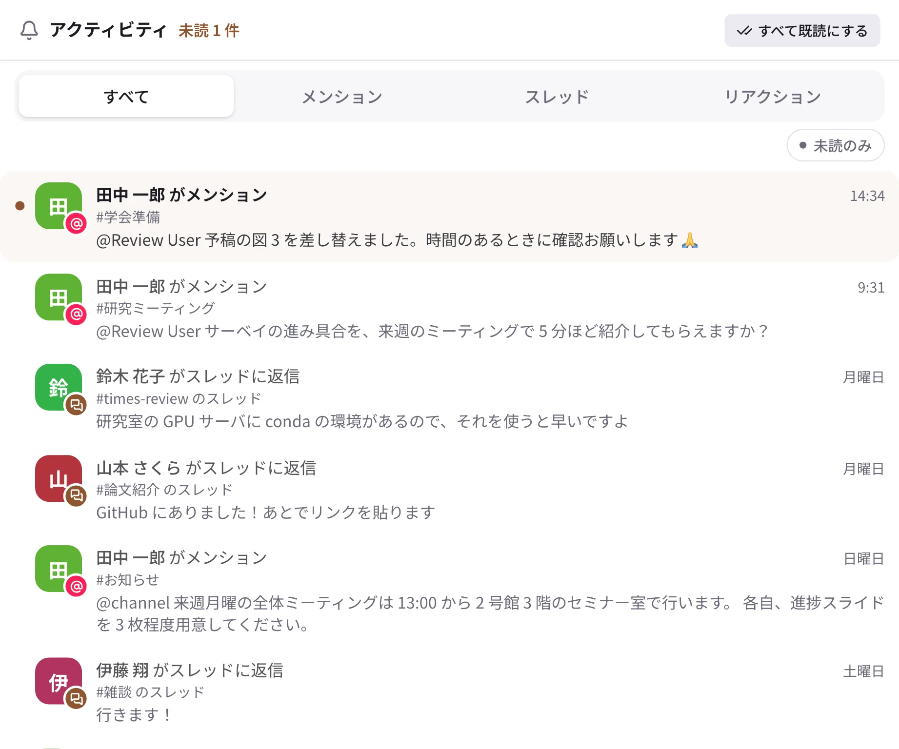
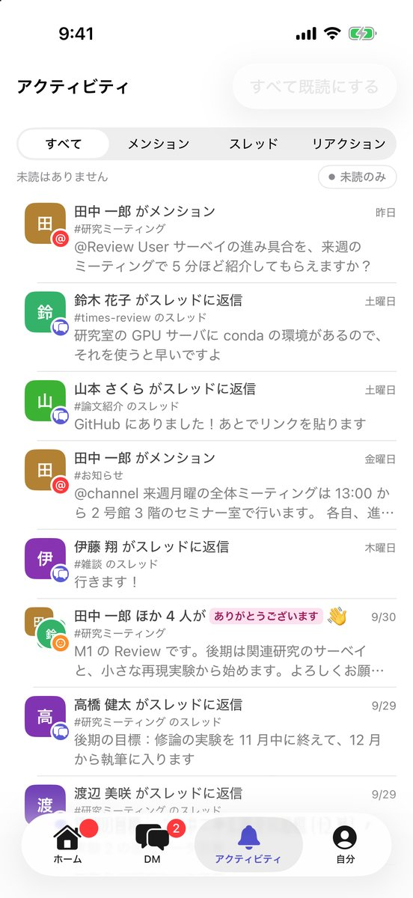
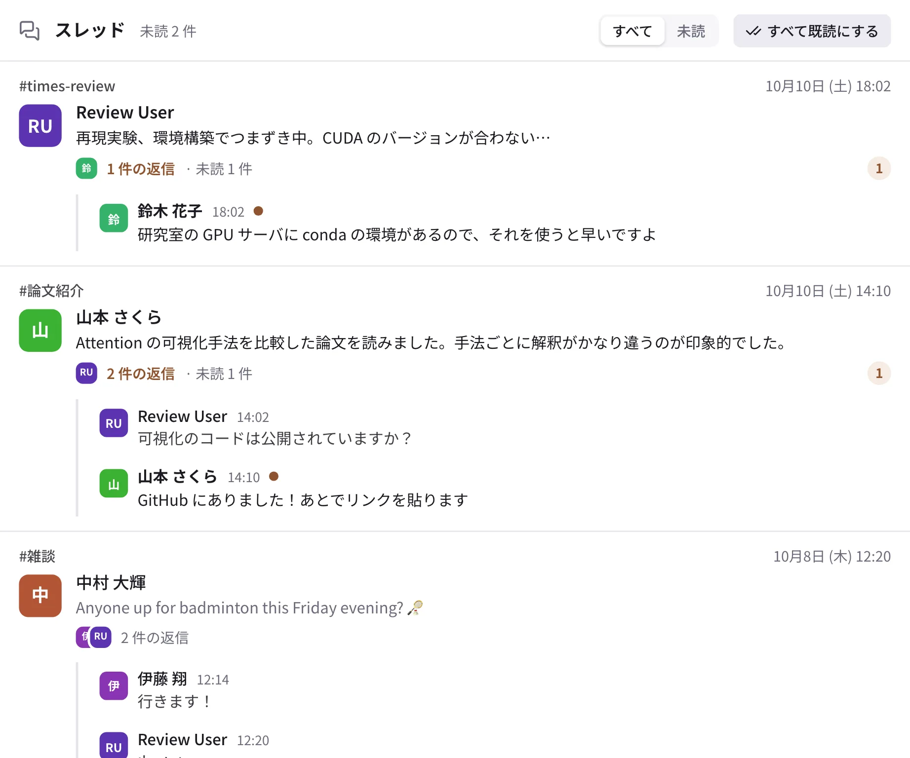
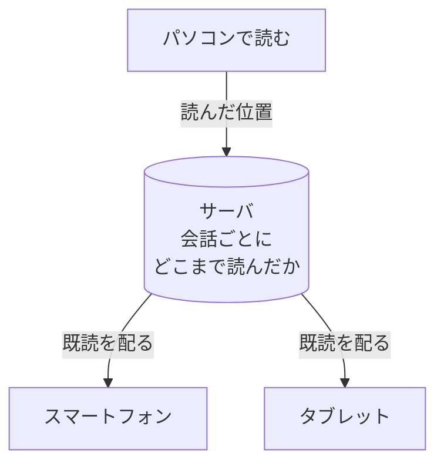

# アクティビティと未読

{ .wide }

## アクティビティ

{ .phone }

左端のアイコン列の「アクティビティ」（ベルのアイコン。スマートフォンは下の「アクティビティ」タブ）に、自分に関係することが
新しい順に集まります。

- 自分へのメンション、グループや `@channel` へのメンション、登録したキーワード
- フォローしているスレッドへの返信
- 自分のメッセージへのリアクション
- キャンバスやドキュメントでのメンション、ページの共有
- タスクの割り当てと期限、予約の担当者への知らせ

上のタブで「メンション」「スレッド」「リアクション」に絞れます。「未読のみ」で、まだ開いていないものだけになります。
項目を開くと既読になります。メンションを開くと、その会話もそのメッセージまで既読になります。まとめて既読にするときは
右上の「すべて既読にする」です。

## スレッド

{ .wide }

サイドバーの「スレッド」に、フォローしているスレッドが新しい返信の順に並びます（デスクトップ版は ++ctrl+shift+t++、macOS は
++cmd+shift+t++ でも開けます）。

- 上の「すべて」「未読」で、未読の返信のあるスレッドだけに絞れます。
- 右上の **すべて既読にする** で、フォロー中のスレッドの返信をまとめて既読にします（スマートフォンも同じ。ほかの端末にも
  反映されます）。
- 返信を押すと、その会話とスレッドが開きます。

## 未読の見かた

- サイドバーで **太字** の会話は未読があり、**赤い数字** は自分あてのメンション（DM は未読の数）です。
- 会話を開くと、前回読んだところに「新着メッセージ」の線が出ます。
- どこまで読んだかはサーバが覚えているので、パソコンで読んだ分はスマートフォンでも既読になります。
- サイドバーの上の「未読」を押すと、未読のある会話だけを表示します。
- 会話を右クリックして「既読にする」「未読にする」も選べます（デスクトップ版・ブラウザ版）。
- 読み直したいメッセージは、⋯ →「ここから未読にする」で未読に戻せます。
- ほかの人の Times は、メンションされたときだけ未読になります（[Times](times.md)）。

## 場所の一覧

| 場所 | 中身 |
| --- | --- |
| スレッド | フォローしているスレッド。新しい返信のあるものが上 |
| 下書き | 送っていない書きかけと、予約送信（「後で送信」）のメッセージ |
| リマインダー | 「リマインド…」を付けたメッセージ。時刻が来たものは赤い数字 |
| 保存済み | 🔖 で保存したメッセージ |
| ファイル | 参加している会話に共有されたファイル |

デスクトップ版・ブラウザ版では「スレッド」「下書き」はサイドバーの行、ほかは左端のアイコン列にあります。置き場所や順番は
変えられます（[サイドバーと表示](sidebar.md)）。スマートフォンでは、ホームのタイルに並びます（「下書き」「リマインダー」は
中身があるときだけ）。
