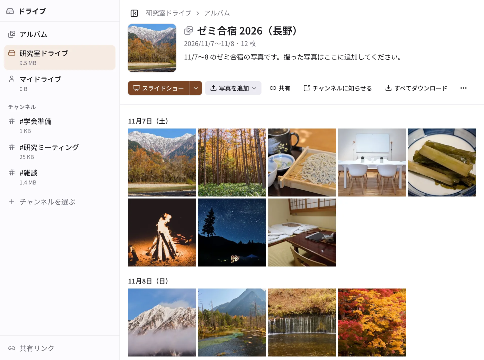

# 写真のアルバム

ゼミ合宿・学会・研究室の行事などの写真を、何人もで 1 か所に集めて、撮影した順に眺めるための機能です。
アルバムは [ドライブ](drive.md) の **フォルダ** に、説明・表紙・日付・並べ方を少し足したものです。見られる人・足せる人は、
アルバムを置いた場所（研究室ドライブ・チャンネルのドライブ・マイドライブ）で決まり、アップロードの再開・ゴミ箱・容量・
ZIP でのダウンロード・共有リンク・検索・バックアップはドライブと同じです。

デスクトップ版・ブラウザ版・iPhone / iPad・Android で使えます。

## どこに作るか

| 写真の種類 | 置く場所 |
| --- | --- |
| 研究室の行事 | **研究室ドライブ**（ゲスト以外の全員が見られます） |
| 共同研究者（ゲスト）も一緒の学会など | その人たちがメンバーの **チャンネルのドライブ** |
| 学外の人にも見せたい | どちらかに作って、[共有リンク](#share) を渡す |
| 自分だけ | **マイドライブ** |

## アルバムを作る

=== "デスクトップ版・ブラウザ版"

    - **ドライブの「アルバム」**：ドライブの場所の一覧のいちばん上の「アルバム」を開くと、見られるすべての場所のアルバムが
      新しい順に並びます。「**新しいアルバム**」で名前・場所・説明・日付を決めて「作成」を押します（既定は研究室ドライブ）。
    - **ドライブの上の行**の「新しいアルバム」：今いる場所の「アルバム」フォルダの中に作ります。フォルダの中にいるときは
      「今のフォルダ（…）に作成」も選べます。
    - **今あるフォルダ**：フォルダの行の ⋯ →「**アルバムにする**」。中の写真はそのままです。
    - **会話の写真から**：写真や動画の付いたメッセージの ⋯ →「**アルバムに追加**」→ いちばん上の「新しいアルバム」
      （写真のビューアの上の行にもあります）。チャンネルならそのチャンネルのドライブに、DM ならマイドライブに、
      「#学会 2026-09-16」のような名前で作ります。

=== "iPhone / iPad"

    - **ドライブ**の画面のいちばん上の「**アルバム**」の節に、表紙のタイルが横に並びます。先頭のタイルが「**新しいアルバム**」です
      （書き込める場所があるときだけ）。
    - **会話の写真から**：メッセージを長押し →「**この投稿の写真をアルバムに追加**」。

=== "Android"

    - ドライブの「**＋**」→「**新しいアルバム**」。場所のいちばん上ではその場所の「アルバム」フォルダに、フォルダの中では
      そのフォルダの中に作ります。
    - **今あるフォルダ**：フォルダの詳細のシート →「**アルバムにする**」。
    - **会話の写真から**：メッセージを長押し →「**この投稿の写真をアルバムに追加**」→「新しいアルバム」か、今あるアルバム。

アルバムのフォルダは、ドライブでもチャンネルの「ドライブ」のタブでも、開くとアルバムの画面になります。ふつうのファイルの
一覧で見たいときは ⋯ →「ファイルの一覧で見る」（戻るときは「アルバムで見る」）。⋯ →「アルバムを解除」で
ふつうのフォルダに戻ります（中の写真や動画は削除されません）。

## 写真を足す

- **写真を追加**：アルバムの画面の「写真を追加」でファイルを選ぶか、デスクトップ版・ブラウザ版ではアルバムの上に
  ドラッグ＆ドロップします。スマートフォンは写真の選択から何十枚もまとめて選べ、アプリを閉じても裏で送り続けます。
  同じ名前の写真（`IMG_1234.jpg` など）は、聞かずに **名前を変えて両方残します**。
- **ドライブから追加**（デスクトップ版・ブラウザ版）：ほかのフォルダの写真と動画を選びます。「追加のしかた」は
  「自動で決める」（同じ場所のものは移動し、ほかの場所のものはコピーする）・「コピーする」・「移動する」から選べます。
- **会話の写真から**：上の「アルバムに追加」「この投稿の写真をアルバムに追加」でアルバムを選びます。チャンネルに投稿した写真は
  もうチャンネルのドライブの「投稿のファイル」にあるので（[投稿のファイル](drive.md#channel-files)）、同じチャンネルのドライブの
  アルバムへは **移動するだけ** です（メッセージの表示は変わりません）。ほかの場所のアルバムへはコピーします。
- 1 枚の写真を 2 つのアルバムに入れるときはコピーします（容量も 2 枚分使います）。

## 見る

{ .wide }

- **格子**：撮影日の順に並び、日付ごとに見出しが付きます（並べ方は撮影日・名前・追加した順から選べます）。動画は ▶ と長さ付きです。
- **全画面**：写真を押すと開きます。← → やスワイプで前後へ。表示には軽い縮小版（長い辺 2048 px）を使い、拡大したときや
  「**元の画像を開く**」を押したときだけ元の写真を読みます。上の行に撮影日時と、撮影場所の情報があれば「位置情報あり」が出ます。
- **スライドショー**：1 枚 3 / 5 / 10 秒、ランダムな順番、「動画を飛ばす」を選べます。動画は音を消して流します（長いものは 60 秒で次へ）。
  デスクトップ版・ブラウザ版は ++space++ で一時停止、++left++ ++right++ で送る、++esc++ で終わります。スマートフォンは表示の間、
  画面を消しません。
- **選ぶ・保存する**：デスクトップ版・ブラウザ版はチェックボックスか ++ctrl++ / ++shift++ ＋クリック（macOS は ++cmd++）で選び、
  ダウンロード（2 枚以上は ZIP）・移動・コピー・表紙にする・ゴミ箱。スマートフォンは長押しで選び、「写真アプリに保存」（Android は
  「写真に保存」）で端末の写真に入れられます。「すべてダウンロード」はアルバム全体の ZIP です。
- **⋯ のメニュー**（デスクトップ版・ブラウザ版）：写真にポインタを合わせると右上に出る ⋯（右クリックでも）に、ドライブの一覧と
  同じ操作が並びます（ダウンロード・共有リンク・会話に送る・リンクをコピー・コピー・名前を変更・移動・ゴミ箱へ、写真 1 枚なら
  「表紙にする」）。アルバムの上の行の ⋯ と、「アルバム」の一覧のカードの ⋯ には、アルバム全体へのリンクのコピー・共有リンク・
  コピー・名前を変更・移動・アルバムを解除・ゴミ箱へがあります。
- 表紙・説明・日付・既定の並べ方は、⋯ →「アルバムの設定」で変えます（デスクトップ版・ブラウザ版、Android）。

## チャンネルに知らせる

アルバムの画面の「**チャンネルに知らせる**」で会話を選ぶと、入力欄にアルバムのリンクと「写真を追加しました（12 枚）」の
下書きが入ります（送るのは自分です）。アルバムのリンクは会話の中で、写真 4 枚・題名・枚数・日付のカードになります。
アルバムを見られない人には「表示できないファイル」とだけ出ます。

写真へのコメントやリアクションはありません。その投稿のスレッドで話してください。

## 学外の人に見せる（共有リンク） { #share }

アルバムのフォルダの「共有」（ドライブの [共有リンク](drive.md#share) と同じ）で、ログインせずに見られるリンクを作れます。
相手のページでは、写真の格子・全画面・動画の再生ができます。

!!! info "アルバムのリンクは、既定で縮小した写真だけを渡します"
    スマートフォンの写真には、撮影した場所（GPS）の情報が入っていることがあります。研究室の中（ドライブを見られる人）には
    元の写真をそのまま渡しますが、**アルバムの共有リンクは既定で縮小版（位置情報などを含まない）だけ** を見せ、保存も縮小版
    （`名前.webp`）になります。元の写真を渡したいときは、リンクを作るときに「元の写真のダウンロードを許す」に印を付けます
    （あとから切り替えもできます）。動画は縮小版が無いので、元のファイルのままです。

## HEIC の写真

- iPhone / iPad のアプリは、送る前に HEIC を JPEG にします（撮影日時と位置情報は残ります）。
- Mac の写真アプリや Android から HEIC / HEIF のまま上げた写真にも、サーバがサムネイルと縮小版を作り、撮影日時を読みます
  （元のファイルは HEIC のまま残り、ダウンロードも HEIC です）。

## 容量の目安

アルバムの写真は、ふつうのドライブのファイルとして場所の容量に数えます（縮小版とサムネイルは数えません）。学会 1 回 300 枚で
1〜2 GB ほどです。
