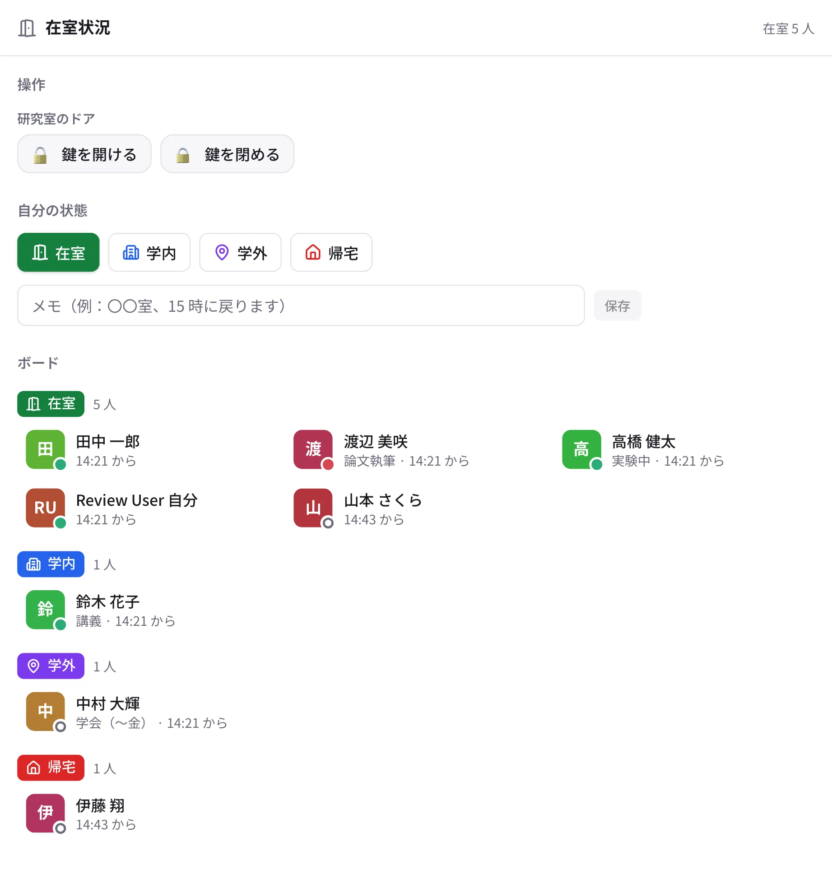
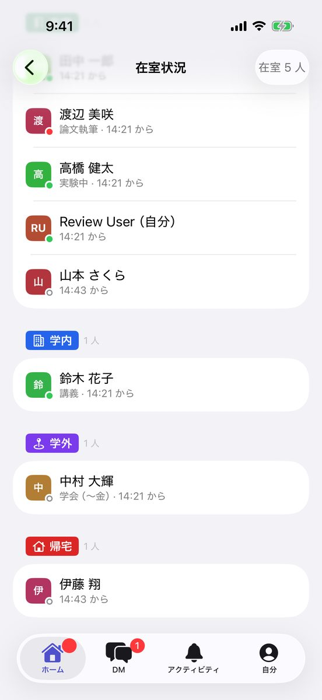
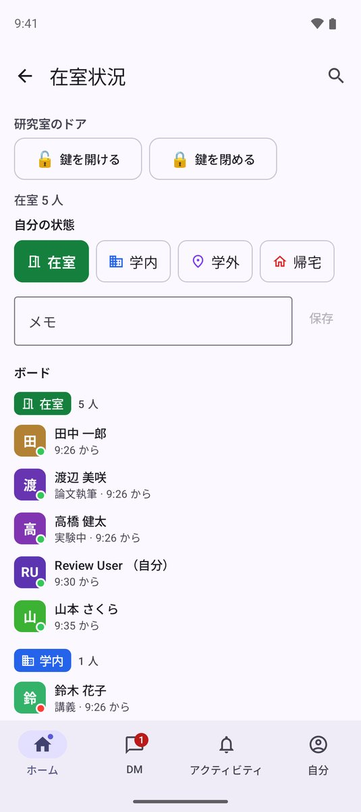
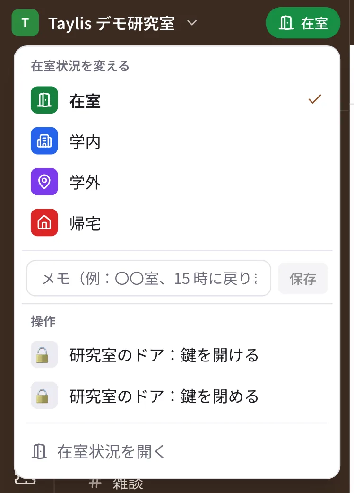
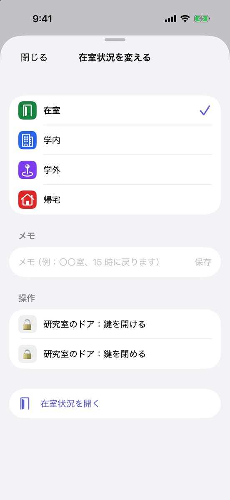
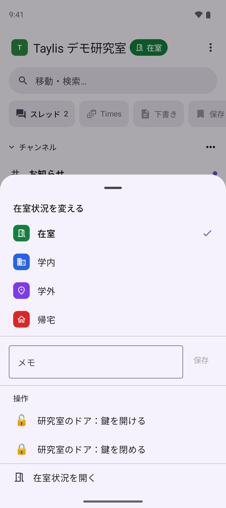
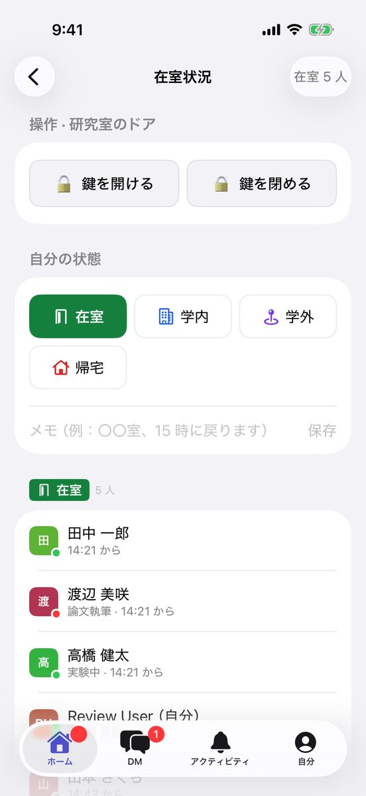
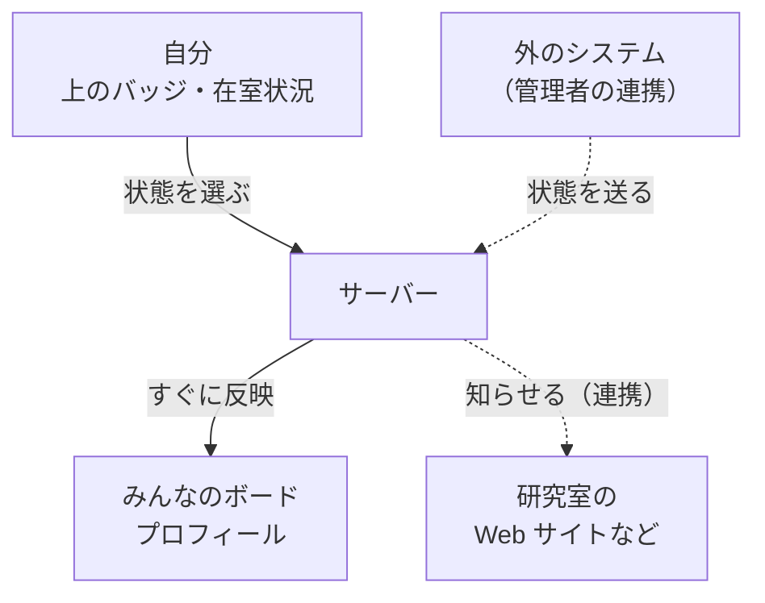

# 在室状況と操作ボタン

どちらも管理者が有効にしたワークスペースだけに出る機能です。

## 在室状況

今どこにいるかを、ワンタップでみんなに知らせます。研究室に誰がいるかが、部屋に行かなくても分かります。

{ .wide }
{ .phone }
{ .phone }

### 状態の種類

既定では次の 4 つです（名前・色・数はワークスペースごとに管理者が変えられます）。

| 状態 | 意味 |
| --- | --- |
| 在室（緑） | 研究室（部屋）にいる |
| 学内（青） | 部屋にはいないが、学内（敷地内）にいる。講義・図書館・実験室など |
| 学外（紫） | 学会・出張・外出など、学外にいる |
| 帰宅（赤） | 今日はもういない |

管理者が許していれば、「自分用の状態を追加」で自分だけの状態（「会議」「出張」など）を足せます。

### 自分の状態を変える

いちばん早いのは、**画面の上のバッジ**（デスクトップ版・ブラウザ版。ワークスペース名の右）です。今の状態（「在室」など）が
色付きで出ていて、押すと状態を選べます。

{ .narrow }
{ .phone }
{ .phone }
{ .phone }

1. 上のバッジ、またはアイコン列の「在室状況」（ドアのアイコン。スマートフォンはホームのタイル）を開きます。
   自分のアイコンを押すと出るメニューの「在室状況」からも選べます。
2. **自分の状態**（在室・学内・学外・帰宅）を押します。必要なら「メモ」（「実験中」「15 時に戻ります」など）を添えて「保存」します。
3. 下の **ボード** に、状態ごとのメンバーと人数、いつからその状態か（「9:26 から」）が出ます。アイコンの右下の丸は、今
   アプリを使っているか（緑）、取り込み中か（赤）を表します。

- プロフィールやメンバーの一覧にも、その人の今の状態が小さく出ます。
- 状態は手で変えるまでそのままです。帰るときは「帰宅」にしておくと、ほかの人が分かりやすくなります。
- 研究室の Web サイトの在室ボードなどと連動していることもあります（管理者の設定）。

## 操作ボタン { #actions }

研究室のドアの鍵のように、外の機器をワンタップで動かすボタンです。アイコン列の「操作」（稲妻のアイコン）、在室状況の画面の上、
上のバッジのメニューに並びます。

1. ボタン（例：「鍵を開ける」）を押します。
2. 確かめの画面で「実行」を押すと、すぐに 1 回だけ実行され、結果（「解錠しました」など）が表示されます。
3. 機器の今の状態（施錠中など）が分かるボタンでは、見出しの下に状態と確かめた時刻が出ます。

押せる人は管理者が決めます（押せないボタンは出ません）。誰がいつ押したかは記録に残ります。

設定は [在室状況と操作ボタン（管理者）](../admin/attendance.md) をご覧ください。
