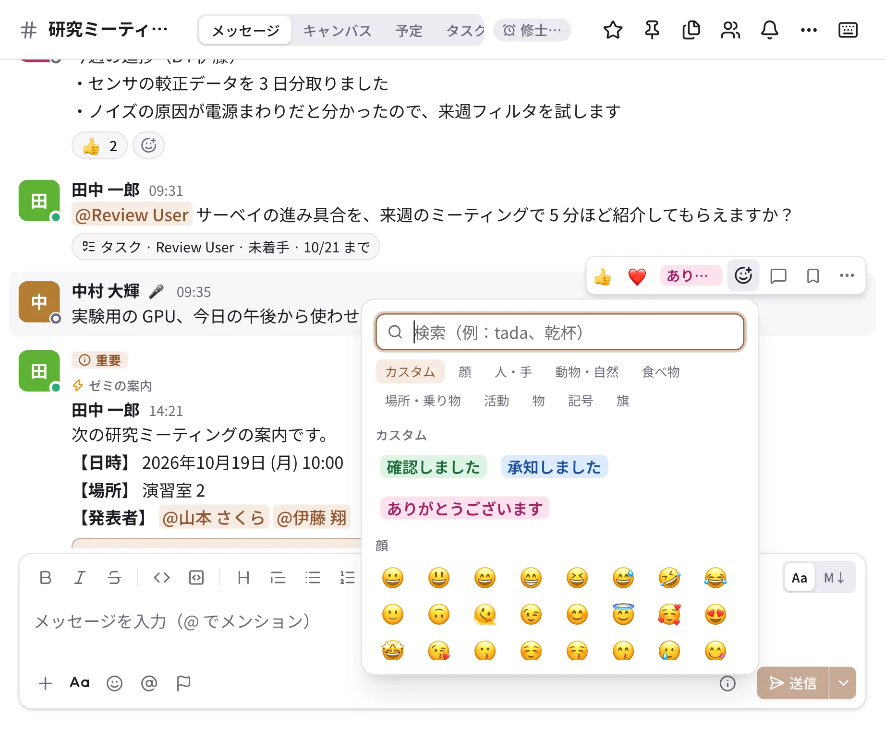
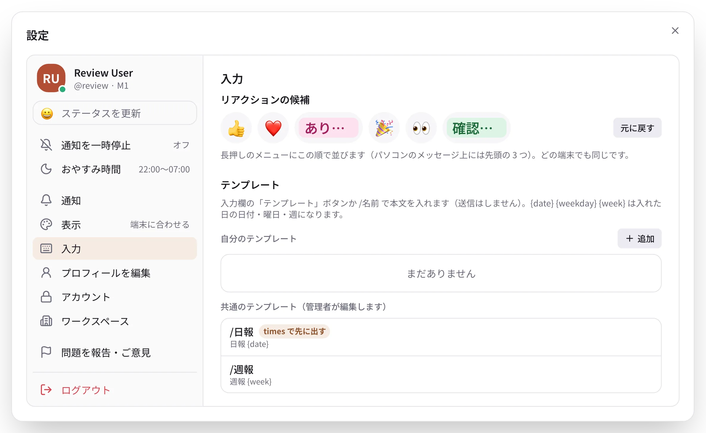

# 絵文字とリアクション

## リアクション

メッセージにポインタを合わせて（スマートフォンは長押しして）リアクションのボタンを押し、絵文字を選びます。
同じ絵文字をもう一度押すと取り消せます。リアクションにポインタを合わせると、誰が押したかが分かります。

{ .wide }

- よく使うリアクションの候補は、設定の「入力」→「リアクションの候補」で自分で選べます（下）。
- 自分の投稿にリアクションが付いたときに通知を受け取るかは、設定の「通知」で決められます。

### リアクションの候補 { #quick-reactions }

スマートフォンでメッセージを長押ししたときに上に並ぶ 6 つ（パソコンではメッセージにポインタを合わせたときのバーに、
先頭の 3 つ）を、自分で決められます。どの端末でも同じ候補になります。

{ .wide }

1. 設定 →「入力」→「リアクションの候補」で、変えたい枠を押します。
2. 出てきたピッカーから絵文字を選びます。標準の絵文字のほか、ワークスペースの **カスタム絵文字**（文字の絵文字やセットの
   絵文字も）を選べます。ほかの枠にある絵文字を選ぶと、2 つの枠が入れ替わります。
3. 「元に戻す」を押すと、自分で決める前の並び（最近使った絵文字から順に、足りない分は 👍 ❤️ 😂 🎉 👀 ✅）に戻ります。

選んだカスタム絵文字が管理者に消されたときは、その枠は飛ばして表示されます（設定の枠には名前が薄く残るので、選び直せます）。

## 絵文字の種類

| 種類 | 見た目 | 使いどころ |
| --- | --- | --- |
| 標準の絵文字 | 😀 🎉 👍 | Unicode の絵文字すべて |
| 画像の絵文字（カスタム絵文字） | ワークスペースで追加した画像 | チームの内輪の絵文字 |
| 文字の絵文字 | 色付きのラベル（例：「確認しました」） | よく使う言葉のリアクション |
| セットの絵文字（スタンプ） | ピッカーのタブにまとまった絵 | LINE のスタンプのような大きな絵 |

- **文字の絵文字** は、小さな画像に文字を詰めるのではなく、読みやすいラベルとして描きます。ゲスト以外なら誰でも
  追加できます（表示する文字は 12 文字まで、色は 8 色から）。
- **横長の画像** は、高さを他の絵文字にそろえ、幅は縦横比どおり（3:1 まで）に表示します。
- **絵文字のセット** は管理者が追加します。ピッカーではセットごとにタブが並びます。

## 絵文字を探す

- ピッカーの検索欄で、名前（`tada`）でも日本語のキーワード（「ありがとう」「おめでとう」）でも探せます。
  カタカナとひらがなは区別しません。
- 入力欄で `:` に続けて英数字 2 文字以上、または日本語 1 文字以上を打つと候補が出ます（`:tada`、`:ありがとう`）。
  全角の `：` でも出ます。
- 本文の `:tada:` のような名前は、表示のときに絵文字になります。

## 大きな絵文字とスタンプ

- 絵文字だけのメッセージ（23 個まで）は、大きく表示されます。
- セットの絵文字を 1 つだけ送ると、**スタンプ** として吹き出しなしで大きく表示されます。
- 動く絵文字は、大きくしても動きます。

## カスタム絵文字を追加する

デスクトップ版・ブラウザ版では、絵文字のピッカーの下の「絵文字を追加」から、画像の絵文字と文字の絵文字を追加できます
（ゲスト以外の誰でも）。画像は PNG・GIF・JPEG・WebP で 256 KB 以下です。名前は英小文字・数字・
`_ + -` で 2〜32 文字です。日本語の名前は付けられませんが、**表示名** と **キーワード** に日本語を入れておくと、
日本語で探せるようになります。

管理者向けの説明（セットの取り込みなど）は [カスタム絵文字とセット](../admin/emoji.md) をご覧ください。
