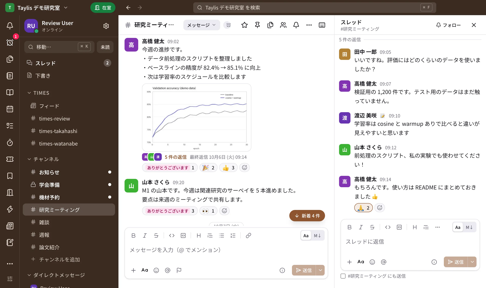
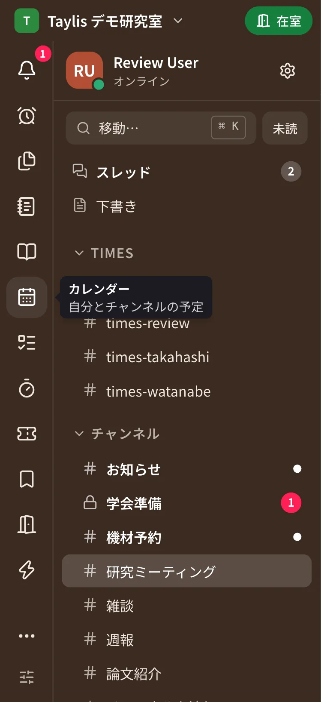
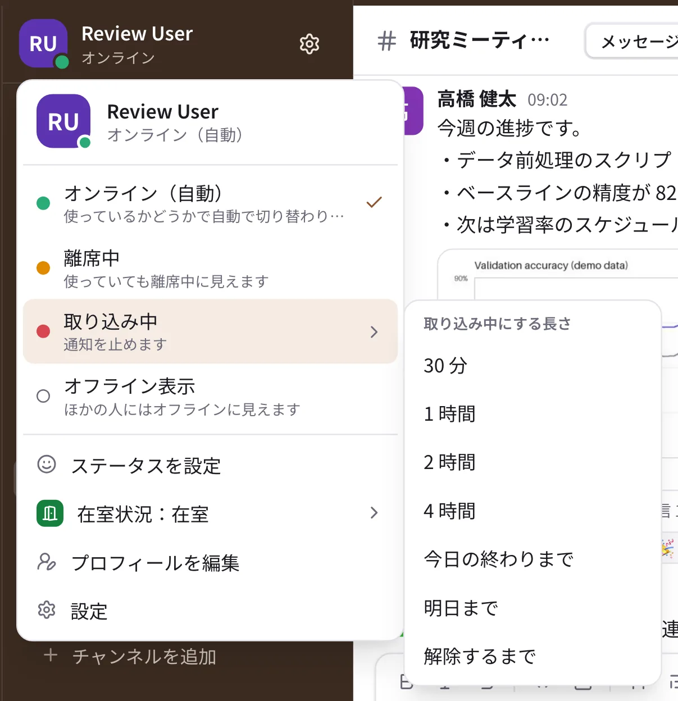

# 使い方

Taylis を使うメンバー向けの説明です。画面はデスクトップ版とブラウザ版のものですが、スマートフォンのアプリでも
同じことができます（違うところはそれぞれのページに書いています）。

## 画面の見かた

{ .full }

- **左端（アイコン列）**：「アクティビティ」「リマインダー」「ファイル」「キャンバス」「ドキュメント」「カレンダー」「タスク」
  「締切」「予約」「保存済み」「在室状況」「操作」などの場所がアイコンで並びます。ポインタを合わせると名前が出ます。
  入りきらない分は下の ⋯（その他）に入ります。
- **左（サイドバー）**：上に自分のアイコンと名前（押すとステータスのメニュー）、「移動…」と「未読」、「スレッド」「下書き」の行。
  その下に Times・チャンネル・DM の一覧。太字は未読、赤い数字は自分あてのメンションです。
- **真ん中**：開いている会話と、メッセージの入力欄。チャンネルの見出しで「キャンバス」「予定」「タスク」に
  切り替えられます。
- **右**：スレッドやメンバーの一覧が開きます。
- **いちばん上**：ワークスペースの名前、在室状況のバッジ（「在室」など。在室状況が有効なとき）、戻る / 進むのボタンと検索欄。
  タブを 2 つ以上開いているときは、その下にタブが並びます。
- **スマートフォン**：下に「ホーム」「DM」「アクティビティ」「自分」の 4 つのタブ。アイコン列の場所は、ホームのタイルに並びます。

どの場所をアイコン列・サイドバーに置くか、タブの使い方は [サイドバーと表示](sidebar.md) をご覧ください。

{ .slim }
{ .half }

## 分野ごとの使い方

-   :material-message-text-outline:{ .lg } **[メッセージとスレッド](messages.md)**

    送る・返信する・直す・あとで読む。[書き方](formatting.md)、[絵文字とリアクション](emoji.md) も。

-   :material-magnify:{ .lg } **[検索](search.md)**

    過去のメッセージ・ファイル・キャンバス・ドキュメントを探す。

-   :material-bell-ring-outline:{ .lg } **[アクティビティと未読](activity.md)**

    メンション・スレッドの返信・リアクション、下書き、保存済み。

-   :material-book-open-page-variant-outline:{ .lg } **[ドキュメント](docs.md)**

    研究室のマニュアルやノートのページと、データベース。

-   :material-note-text-outline:{ .lg } **[キャンバス](canvas.md)**

    チャンネルや DM に付ける共有のメモ。

-   :material-checkbox-marked-outline:{ .lg } **[タスクと締切](tasks.md)**

    自分のタスク、チャンネルのボード、締切のカウントダウン。

-   :material-calendar-month-outline:{ .lg } **[カレンダーと日程調整](calendar.md)**

    予定、iCal での購読、アンケートと日程調整。

-   :material-notebook-edit-outline:{ .lg } **[Times](times.md)**

    自分の作業ログと、みんなの Times のフィード。

-   :material-form-select:{ .lg } **[ワークフローと定期投稿](workflows.md)**

    決まった形の報告、毎週の週報の回収、テンプレート。

-   :material-calendar-clock:{ .lg } **[予約](reservations.md)**

    共有の機材やアカウントを時間で予約する。

-   :material-door-open:{ .lg } **[在室状況と操作ボタン](attendance.md)**

    今どこにいるかを知らせる。研究室の鍵などを開ける。

-   :material-robot-outline:{ .lg } **[AI](ai.md)**

    AI のボット、要約、AI に聞く（管理者が有効にしたとき）。

-   :material-bell-outline:{ .lg } **[通知の設定](notifications.md)**

    端末ごとの許可、会話ごとの通知、おやすみ時間（既定は 22:00〜7:00）、テスト通知。

-   :material-dock-left:{ .lg } **[サイドバーと表示](sidebar.md)**

    アイコン列とタブ、セクション、並べ替え、ステータス、テーマの色、言語、文字の大きさ。

## よく使う操作

| やりたいこと | 操作 |
| --- | --- |
| スレッドで返信する | メッセージにポインタを合わせて（スマートフォンは長押しして）「スレッドで返信」 |
| リアクションする | メッセージの 😊＋（リアクションを追加）、スマートフォンは長押し |
| メッセージを直す・消す | 自分のメッセージの ⋯（スマートフォンは長押し）から「編集」「削除」 |
| あとで読む | メッセージの 🔖（あとで見る）、または ⋯ →「リマインド…」 |
| チャンネルを探して参加する | サイドバーの「チャンネルを追加」→「チャンネルを探す」 |
| 移動・検索 | 上の検索欄。会話やページへの移動は ++ctrl+k++（macOS は ++cmd+k++） |
| 別のタブで開く | 会話やアイコンを右クリック →「新しいタブで開く」、または ++ctrl++ を押しながらクリック（macOS は ++cmd++） |
| ファイルを送る | 入力欄の ＋、またはファイルを会話にドラッグ＆ドロップ |
| アンケートや日程調整を作る | 入力欄の ＋ →「アンケート」「日程調整」 |
| 離席中・取り込み中にする | 左上の自分のアイコンと名前 →「離席中」「取り込み中」 |
| ステータスを出す | 左上の自分のアイコンと名前 →「ステータスを設定」 |
| 在室状況を変える | 上のバッジ（「在室」など）→ 状態を選ぶ |

困ったときは [FAQ](../faq.md) もご覧ください。
