# メッセージとスレッド

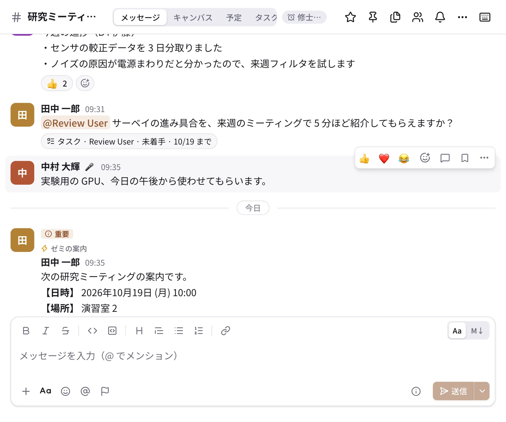{ .wide }

## メッセージを送る

1. サイドバーでチャンネルか DM を選びます。
2. 下の入力欄に書きます。`@` で人やグループをメンションでき、`:` で絵文字の候補が出ます。
3. 送信ボタンか、送信キーで送ります（既定はデスクトップ版が ++ctrl+enter++、macOS は ++cmd+enter++。設定 →「入力」で
   ++enter++ などに変えられます）。

太字や箇条書きなどの書き方は [メッセージの書き方](formatting.md) をご覧ください。

- 書きかけの文は **下書き** として保存され、ほかの端末でも続きを書けます。送っていない下書きは、サイドバーの「下書き」に
  出ます。
- 通信が切れていても送信は消えません。つながったときに送り直され、二重に届くことはありません。

### ファイルや写真を付ける

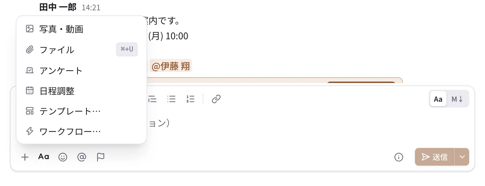{ .wide }

入力欄の ＋ →「写真・動画」または「ファイル」で選びます。1 つのメッセージに 10 個まで、1 ファイルの上限は既定で 100 MB です。
それより大きなファイルは、「ドライブにアップロードしてリンクを投稿」でドライブに上げてリンクを送れます
（[大きなファイル](drive.md#big-files)）。
デスクトップ版とブラウザ版では、＋ →「ドライブから」でドライブのファイルのリンクかコピーも送れます
（[ドライブ](drive.md#conversations)）。

公開・非公開チャンネルに付けたファイルは、そのチャンネルのドライブの「投稿のファイル」にも自動で入ります
（[投稿のファイル](drive.md#channel-files)）。DM の添付は、メッセージの ⋯ →「ドライブに保存」でドライブに残せます。
写真は ⋯ →「アルバムに追加」（スマートフォンは長押し →「この投稿の写真をアルバムに」）で [アルバム](albums.md) に入れられます。

デスクトップ版とブラウザ版では、Finder やエクスプローラーから **会話やスレッドの上にファイルをドラッグ** しても付けられます
（貼り付けでも）。会話全体が落とし先になり、どこに付くか（「#研究ミーティング に添付」「スレッドに添付」）が出ます。
アーカイブされたチャンネルなど送れない所では「ここにはアップロードできません」と理由が出ます。

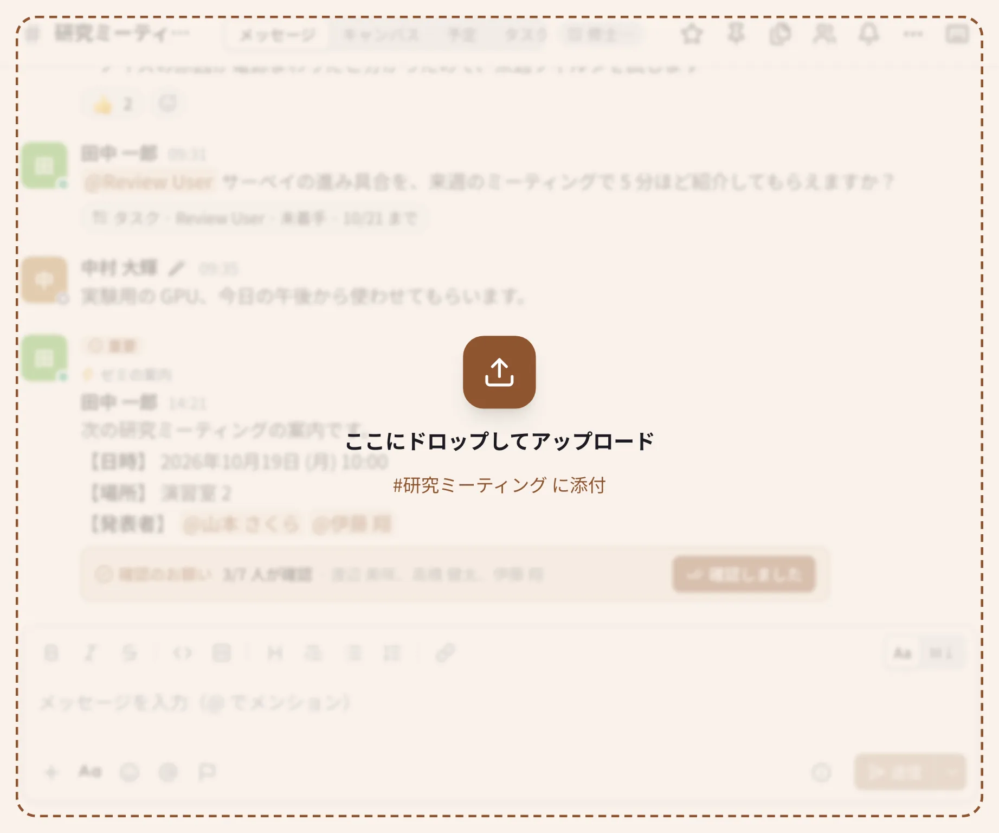{ .wide }

### ほかのアプリから送る（iPhone / iPad・Android）

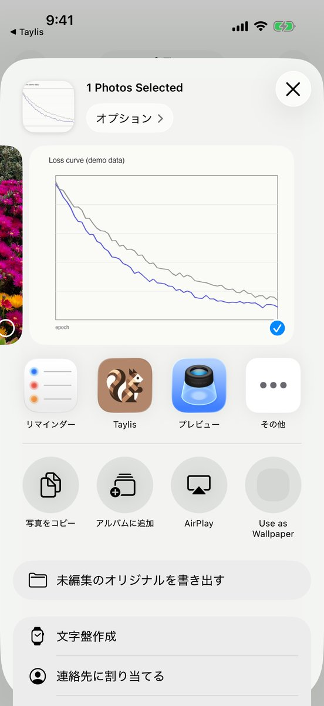{ .phone }
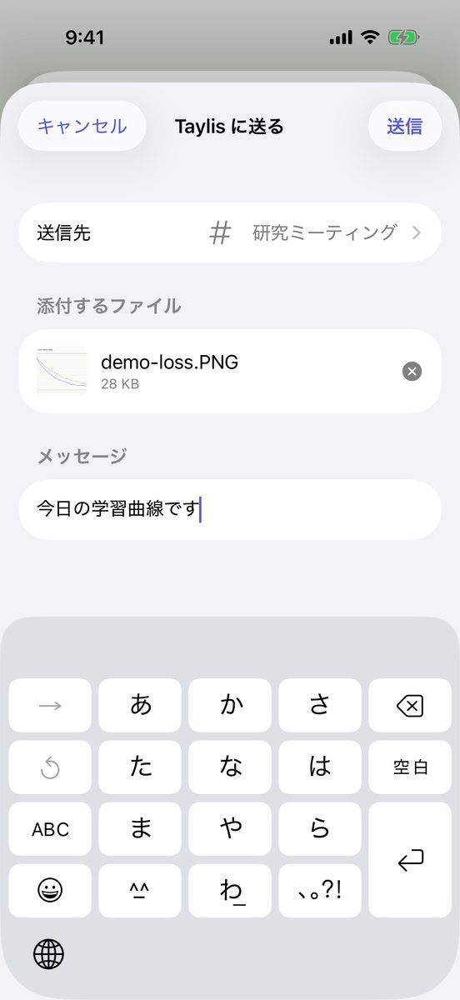{ .phone }
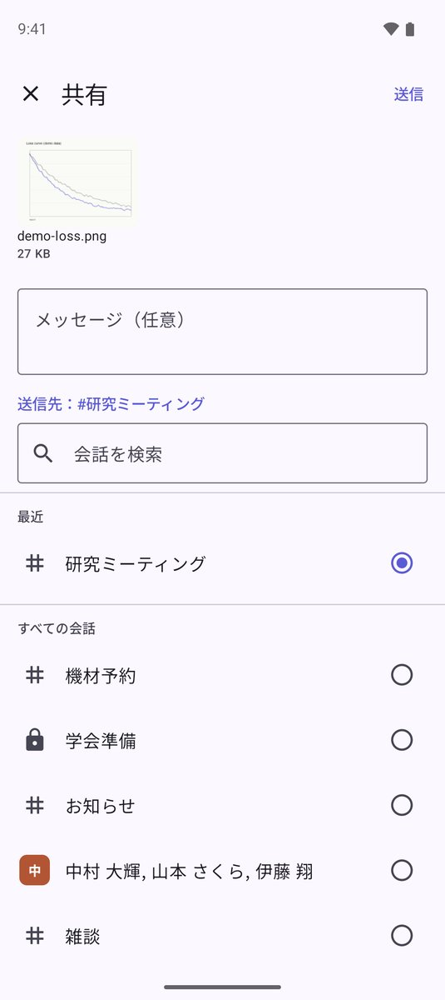{ .phone }

写真・ファイル・PDF・Safari や Chrome のページなどを、そのアプリの **共有** から Taylis の会話に送れます。

1. ほかのアプリで共有のボタンを押し、一覧から **Taylis** を選びます。
2. 送り先の会話を選びます（最近の会話と検索。ワークスペースが 2 つ以上なら、その切り替えも）。
3. 必要ならメッセージを書き足して「送信」を押します。共有したリンクや文章は、メッセージの欄に入っています。

添付の数と大きさの上限はアプリの中と同じです。送れるのは、自分が参加していて投稿できる会話だけです。
iPhone では、先に Taylis のアプリを開いてサインインしておいてください。

### ファイルを見る・保存する

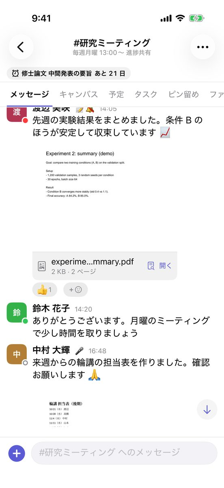{ .phone }
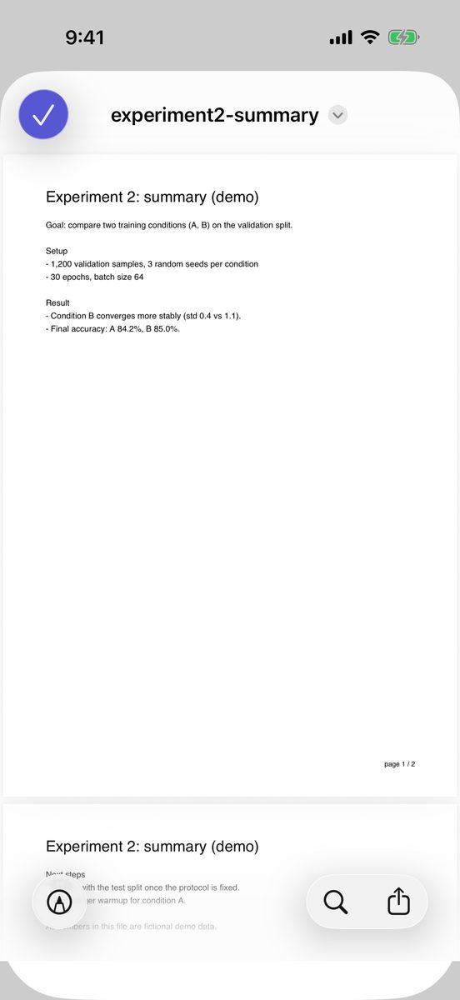{ .phone }

PDF や Word・Excel・PowerPoint は、1 ページ目のサムネイル付きで表示され、押すとアプリの中で全ページを見られます。

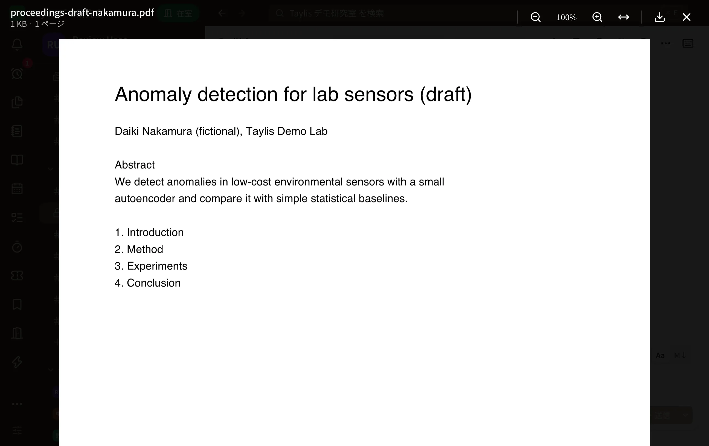{ .wide }

- **デスクトップ版・ブラウザ版**：写真・動画・文書は、アプリを暗くした上の真ん中のカードで開きます。拡大・縮小（50〜300%）、
  幅に合わせる、++left++ / ++right++ で前後のページへ。閉じるには ++esc++、右上の ×、または **カードの外（暗い所）や
  ページの周りの暗い所を押します**。ページの上でのドラッグ（文字の選択など）では閉じません。
- **ウィンドウを動かす（デスクトップ版）**：ビューアが開いていても、カードの上の帯と見出しの行をドラッグすれば
  ウィンドウを動かせます（ダブルクリックで最大化）。
- **ダウンロード（デスクトップ版）**：OS の「ダウンロード」フォルダに保存し、右下に進み具合と「ダウンロードしました」が出ます。
  そのトーストの **開く**（既定のアプリで開く）と **フォルダを開く**（Finder・エクスプローラーで表示）が使えます。毎回保存先を
  選びたいときは、設定 →「入力」→「ダウンロード」の「保存先を毎回選ぶ」をオンにします。ブラウザ版はブラウザのダウンロードの
  機能で保存されます。
- **スマートフォン**：写真もドキュメントも、**下へ引くと閉じます**（ページを途中まで読んでいるときは、いちばん上まで戻ってから）。
  写真を 1 回押すと上下のバーが隠れ、もう 1 回で戻ります。
- **音声**（デスクトップ版・ブラウザ版）：WAV・MP3・M4A・Ogg・FLAC などの音声ファイルは、メッセージの中の 1 行のプレーヤーで
  その場で再生できます（ドライブのビューアでも）。
- **動画**：会話の中でそのまま再生します。デスクトップ版で再生できない形式のときは、そう出て「ダウンロード」で開けます。
- **動く GIF**：スマートフォンでも会話の中とビューアで動きます（会話の中で動かすのは 8 MB までの GIF。省電力の設定などで止まることがあります）。
- **透明な画像**（PNG のロゴなど）は、ビューアで後ろに市松模様を敷いて表示します。
- **HEIC の写真**（Mac や Android から送ったもの）にもサムネイルが付きます。

### あとで送る（予約送信）

送信ボタンの右の ⌄ →「後で送信」で日時を選びます。送るまではサイドバーの「下書き」にあり、「今すぐ送信」や取り消しが
できます。

### 重要度と確認のお願い

入力欄の 🏳（重要度）で「重要」「緊急」の印や **「確認を求める」** を付けられます。確認を求めたメッセージには
「確認しました」のボタンが付き、誰が確認したか、まだの人が何人かを送った人が確かめられます。

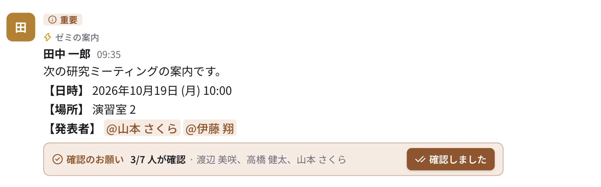{ .wide }

## スレッドで返信する

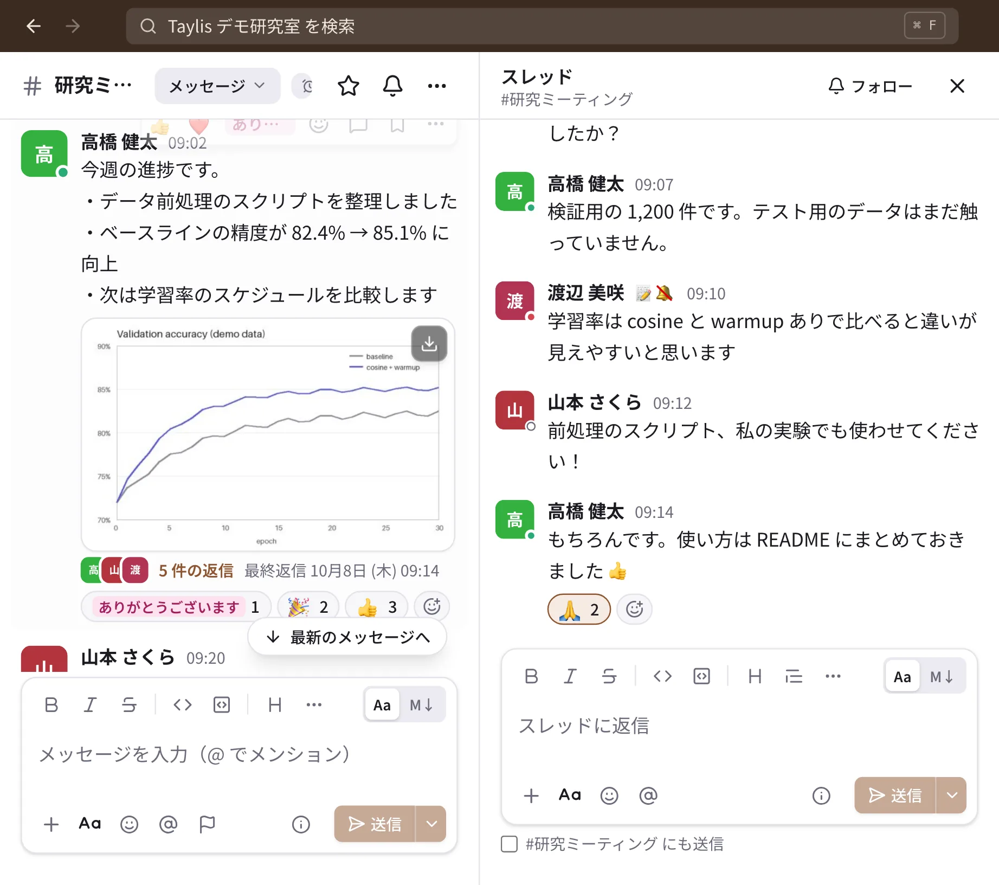{ .wide }

1. メッセージにポインタを合わせ（スマートフォンは長押しし）、💬「スレッドで返信」を押します。右にスレッドが開きます。
2. スレッドの入力欄に書いて送ります。
3. みんなに知らせたい返信は、入力欄の下の **「#チャンネル名 にも送信」** にチェックを入れると、チャンネルにも出ます。

返信したスレッドや、自分のメッセージに付いたスレッドは自動で **フォロー** され、新しい返信がサイドバーの「スレッド」と
[アクティビティ](activity.md) に届きます。スレッドの右上の「フォロー」で、フォローをやめたり始めたりできます。

## メッセージの操作

メッセージにポインタを合わせると出るボタンと、⋯（その他）のメニューから操作します。スマートフォンはメッセージを長押しします。

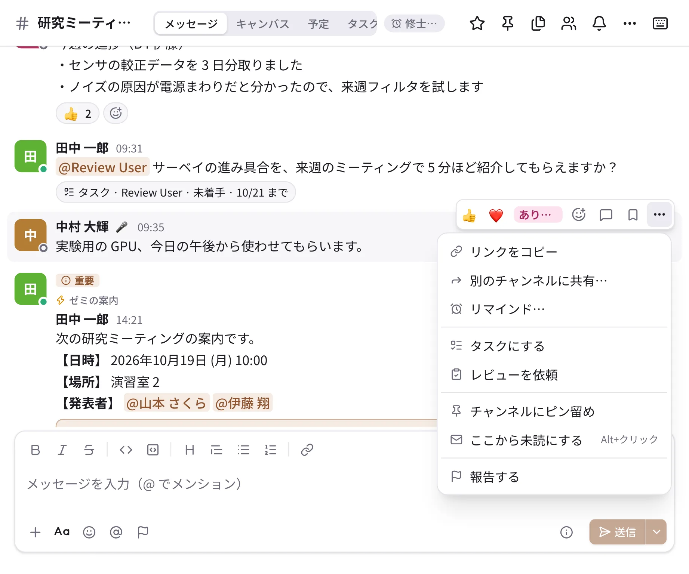{ .wide }
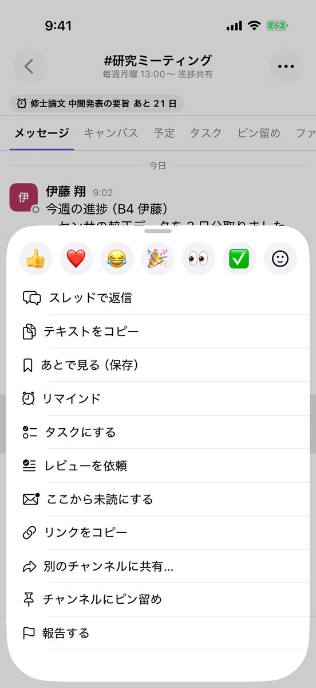{ .phone }

| 操作 | 内容 |
| --- | --- |
| ✏️ 編集 | 自分のメッセージを直します（空の入力欄で ++up++ でも）。直した後は「（編集済み）」と出て、編集の履歴も見られます |
| 🔖 あとで見る（保存） | アイコン列の「保存済み」に入れます |
| リマインド… | 決めた時刻に、そのメッセージを知らせてもらいます（届いたら「リマインダー」で「完了」に。[リマインダーを完了する](activity.md#reminders)） |
| リンクをコピー | メッセージへのリンク（`https://サーバ/m/…`）をコピーします |
| 別のチャンネルに共有… | ほかの会話にメッセージを引用して送ります |
| タスクにする | メッセージからタスクを作ります（[タスクと締切](tasks.md)） |
| レビューを依頼 | DM のメッセージ（論文の原稿など）の添削を相手に頼みます |
| チャンネルにピン留め | チャンネルの 📌 の一覧に残します |
| ここから未読にする | あとで読み直したいところに未読の印を戻します |
| 報告する | 不適切なメッセージを管理者に知らせます |
| 削除 | 自分のメッセージを消します（元に戻せません）。チャンネルの添付は、確認で「ドライブのファイルもゴミ箱に移す」を選べます（[投稿のファイル](drive.md#channel-files)） |
| アルバムに追加 | 写真・動画をドライブの [アルバム](albums.md) に入れます |

## DM を始める

サイドバーの DM の ＋（新しい DM）で相手を選びます。名前・ユーザー名の一部を打つと、人を絞り込めます（スマートフォンも同じ）。
2 人以上選ぶとグループ DM になります。チャンネルにメンバーを追加するときも、同じように名前で探せます。

## DM の整理

- **上に固定**：よく使う DM（自分だけの DM も）を、DM の一覧の先頭に固定できます。
- **会話を閉じる**：使わなくなった DM を一覧から隠します。新しいメッセージが来るか、自分で開くと戻ります。

どちらも DM の ⋯（会話の操作）か、一覧の右クリック（スマートフォンは長押し）から選びます。
