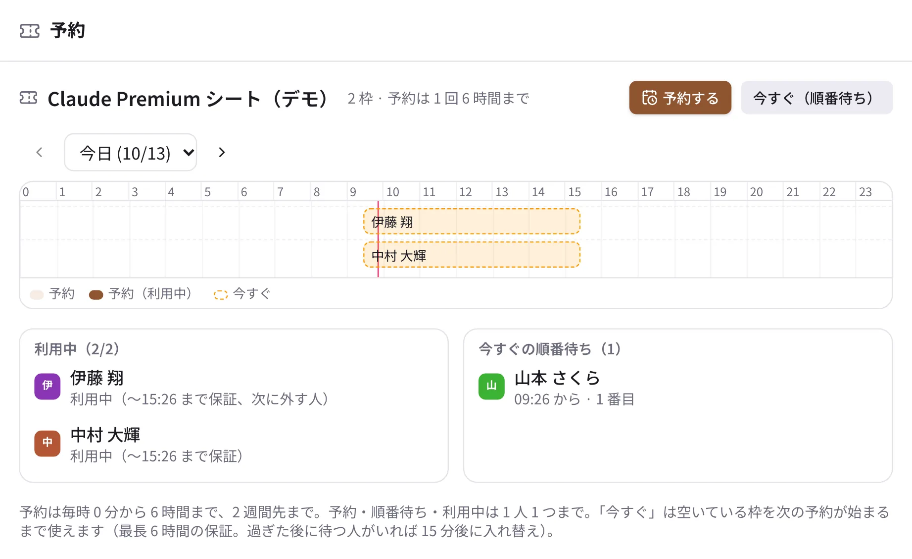
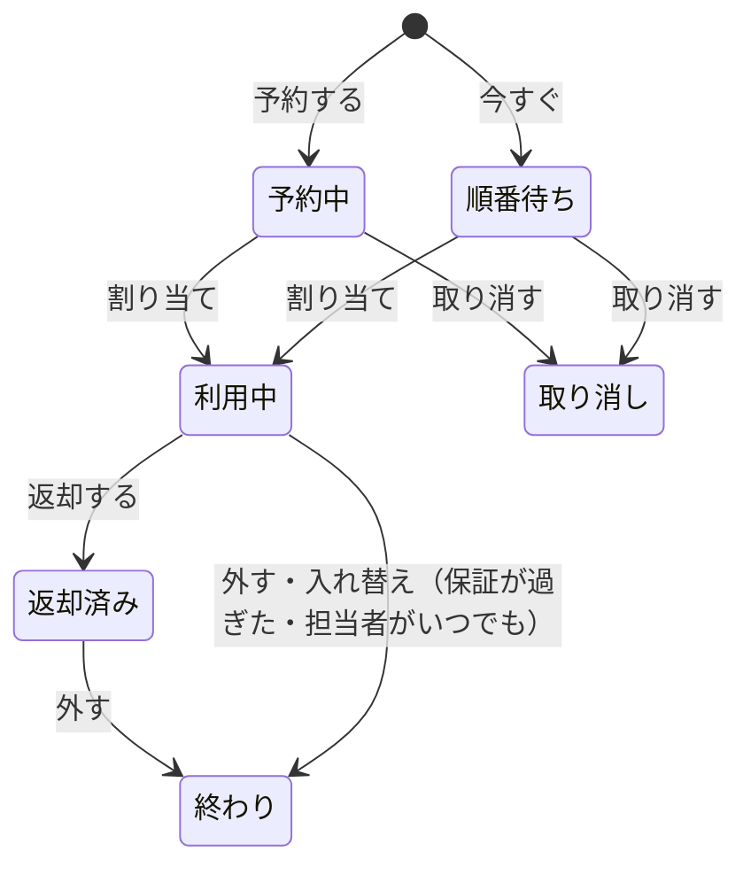

# 予約

共有の機材・計算機・アカウントのシートのように、数に限りのあるものを順番に使うための機能です。管理者が「枠」を作ると、
アイコン列（スマートフォンはホームのタイル）に「予約」が出ます。カメラや PC のように 1 つずつの物を数日持ち出すときは、
[備品の貸し出し](lending.md) を使います。

{ .wide }

!!! info "Taylis は機材やサービスを操作しません"
    Taylis が受け持つのは、予約の記録・順番・知らせだけです。実際の付け替え（たとえばサービスの管理画面でシートを
    渡す）は **担当者** が手で行い、終わったら Taylis のボタンで記録します。

## 予約する

1. アイコン列の「予約」（スマートフォンはホームのタイル）を開き、使いたい枠を選びます。
2. 「予約する」で日付・開始の時刻・長さを選びます。
    - 開始は毎時 0 分、長さは 1 時間単位で、枠ごとに決められた最長まで（既定 6 時間）です。長さは最初から最長に
      なっています。次の予約などで最長まで取れないときは取れるいちばん長い時間になり、理由（「15:00 から埋まっているため、
      最長 3 時間です」）が出ます。
    - 2 週間先まで予約できます。いっぱいの時間は選べません。
    - 1 つの枠で持てるのは **1 人 1 つ** です（予約・順番待ち・利用中のどれか 1 つ）。すでにあるときは「予約する」と
      「今すぐ（順番待ち）」が押せず、「すでに予約があります（…）」と自分の予約へのリンクが出ます。次を取るには、
      今の予約を取り消すか、使い終わって返却し担当者が外すのを待ちます。
3. 予約の時間になると担当者が割り当て、予約した人に「〇〇が割り当てられました」と知らせが届きます。

割り当ての前なら予約を **取り消せます**。次の時間が空いていれば 1 時間ずつ **延長** でき、使い終わったら
「返却する」を押します。

予約と今すぐ（順番待ち）は、次のように進みます。割り当てと外す作業は担当者が行います。

## 今すぐ使いたいとき（順番待ち）

!!! note "予約だけの枠もあります"
    「今すぐ」を受け付けるかは枠ごとに決まっています。受け付けない枠には「この枠は予約だけです」と出て、
    「今すぐ（順番待ち）」のボタンはありません。「予約する」で時間を選んでください。順番待ちの途中で枠が予約だけに
    変わったときは、順番待ちは取り消され、知らせが届きます。

「今すぐ（順番待ち）」を押すと、空いている枠を **保証の時間** だけ使えます（「（13:00 まで保証）」のように表示されます）。
保証は割り当てから決まった時間（既定 6 時間）で、次の予約が始まる時刻より後にはなりません。

- 空きがなければ順番待ちになり、順番が来ると担当者が割り当てます。
- 保証の時間内は外されません。保証を過ぎて待っている人がいるときは、猶予（既定 15 分）の後に入れ替えになります。
  予約の人が来るときは、その時刻に入れ替えです（10 分前に知らせが届きます）。
- **待っている人がいなくても、保証を過ぎると担当者が外します。** 保証が過ぎたときに「保証の時間が過ぎました。担当者が
  外すことがあります」と知らせが届きます。使い終わっていれば「返却する」を押してください。
- 予約した人は、開始の時刻から必ず使えます。今すぐの人も、保証の時間内は担当者の作業には出ません。

## タイムライン

枠のページでは、その日の 0〜24 時の **タイムライン**（スマートフォンは時間ごとの一覧）で、予約・利用中・今すぐの人が
見えます。自分の予約は縁取りで表示されます。

## 担当者の方へ

担当者には、作業の知らせがアクティビティとプッシュ通知で届きます（予約の 10 分前、空きができたとき、入れ替えのとき、
返却されたときなど）。

1. 知らせに従って、外のサービスや機材で実際に付け替えます。
2. 枠のページの「担当者の作業」で「割り当てた」「外した」「入れ替えた」を押します。
3. ほかの担当者への同じ知らせは「対応済み」になります。

予約の割り当ては、開始の 10 分前から押せます。

今すぐの人の保証が過ぎると、待っている人がいなくても「外した」の作業が出ます（「〇〇 さんの保証時間（09:32 まで）が
過ぎました」）。待っている人がいれば、その代わりに入れ替えの作業になります。

作業に出ていなくても、利用中の一覧の行の「外す」で、だれでもいつでも外せます（確認が出ます。スマートフォンは担当者に
「利用中」の一覧が出ます）。外された人には知らせが届きます。使っている本人は「外す」ではなく「返却する」を押します。

枠の作り方は [予約の枠](../admin/reservations.md) をご覧ください。
