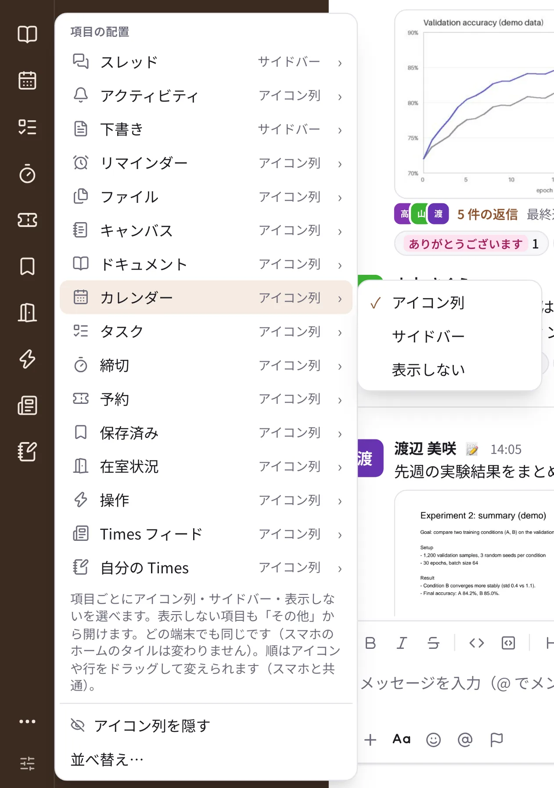
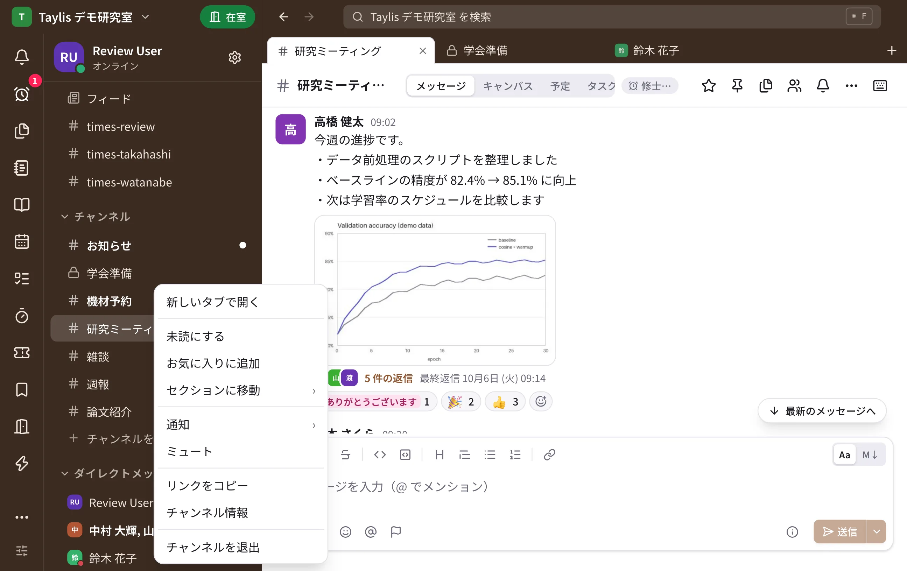
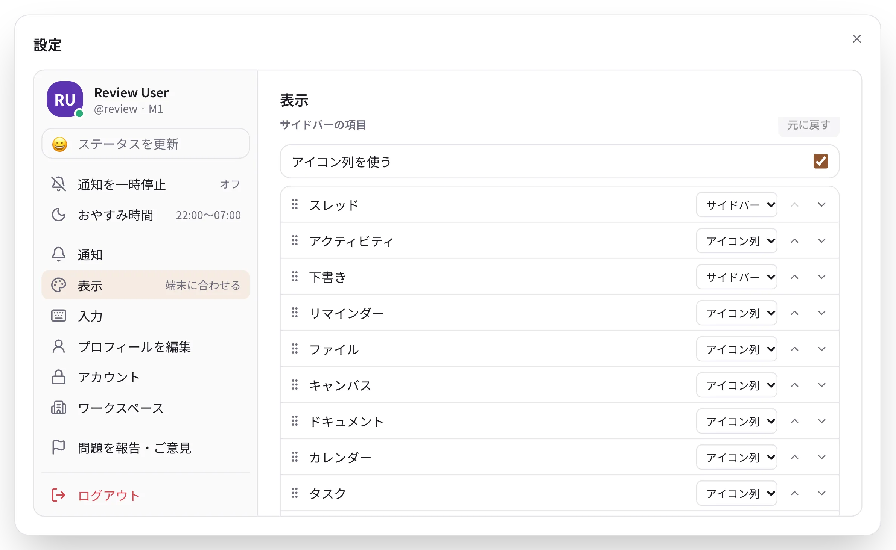
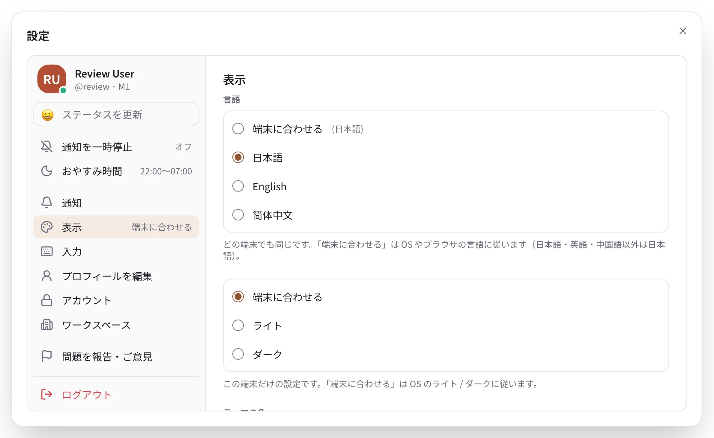
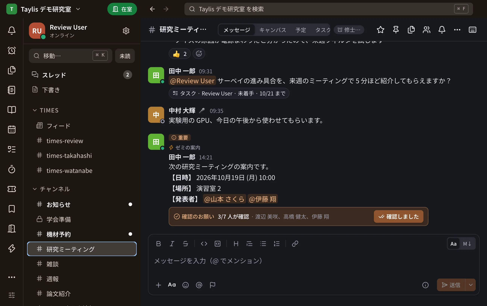

# サイドバーと表示

## アイコン列（デスクトップ版・ブラウザ版）

画面の左端の細い列に、「アクティビティ」「リマインダー」「ファイル」「キャンバス」「ドキュメント」「カレンダー」「タスク」「締切」
「予約」「保存済み」「在室状況」「操作」「Times フィード」「自分の Times」などの **場所** がアイコンで並びます。
おかげでサイドバーは、すぐにチャンネルの一覧から始まります。

- ポインタを合わせると、名前と説明が出ます。開いている場所のアイコンは塗られ、未読やメンションはアイコンの右上の数字で
  分かります（赤はメンションなど、急ぐもの）。
- 窓の高さに入りきらない分と、「表示しない」にした場所は、下の **⋯（その他）** から開けます。
- アイコンを別のアイコンの上へドラッグすると並べ替えられます（上半分なら前、下半分なら後ろに入り、線で位置が出ます）。
  サイドバーの場所の行どうしも同じです。この順はスマートフォンのホームのタイルの順と共通です。
- キーボードでは、アイコン列に 1 回 ++tab++ で入り、++up++ / ++down++ で移り、++enter++ で開きます。

{ .narrow }

### 置き場所を選ぶ

アイコン列のいちばん下の **項目の配置**（つまみのアイコン）で、場所ごとに置き場所を選びます。変えるとすぐ保存されます。

| 置き場所 | 見え方 |
| --- | --- |
| アイコン列 | 左端の列のアイコン（「スレッド」「下書き」以外の既定） |
| サイドバー | サイドバーの上の行（「スレッド」「下書き」の既定） |
| 表示しない | 「その他」の中だけ |

- 「アイコン列を隠す」でアイコン列そのものをなくせます。そのときは、アイコン列の場所がサイドバーの行になります。
- 置き場所はアカウントに保存され、ほかのパソコンやブラウザでも同じになります（スマートフォンのホームのタイルは変わりません）。
- 設定 →「表示」→「サイドバーの項目」でも、置き場所と順番を変えられます（下の [サイドバーの項目](#places)）。

## タブ（デスクトップ版・ブラウザ版） { #tabs }

ブラウザのように、会話・スレッド・ドキュメントのページ・場所を別のタブに開いておけます。

{ .wide }

- **開く**：サイドバーの会話・アイコン列のアイコン・スレッドの一覧のカード・ドキュメントの木の行を右クリックして
  **新しいタブで開く**、または ++ctrl++ を押しながらクリック（macOS は ++cmd++）。新しいタブに切り替わります。
  中クリックなら、今の画面はそのままで後ろに開きます。
- タブの列の右端の **＋**（デスクトップ版は ++ctrl+t++、macOS は ++cmd+t++）は「移動・検索」を開きます。選んだ会話が新しいタブに
  なります（何も選ばずに閉じればタブは増えません）。
- **閉じる**：タブの ×、タブの中クリック、デスクトップ版は ++ctrl+w++（macOS は ++cmd+w++）。最後の 1 つは閉じません。
- **並べ替え**：タブをドラッグするか、タブを右クリック →「左へ移動」「右へ移動」。
- 後ろのタブに新しいメッセージが来ると、タブに未読の印が付きます。後ろのタブの会話は、開くまで既読になりません。
- タブが 1 つのときはタブの列は出ません。開いているタブは次の起動でも戻ります（この端末だけ）。
- ブラウザ版はブラウザのキーとぶつからないよう、++alt+t++・++alt+w++ などを使います（キーの一覧は ++ctrl+slash++）。
- タブを使わないときは、設定 →「表示」→「タブを使う」をオフにします（端末ごと）。

## セクション

サイドバーのチャンネルや DM は、自分で作ったセクションにまとめられます（例：「授業」「研究」「プロジェクト」）。

- **作る**：「チャンネル」の見出しの ⋯ →「新しいセクション…」、会話の右クリックのメニュー、またはサイドバーの空いた所の
  右クリックで作ります。
- **会話を入れる**：会話をセクションの見出しにドラッグするか、会話を右クリックして「セクションに移動」
  （デスクトップ版・ブラウザ版）。
- **並べ替える**：セクションの見出しをドラッグします。キーボードでは見出しの ⋯ の「上へ」「下へ」。
- **アイコン**：セクションには絵文字か **文字のアイコン**（英数字 1〜2 文字か日本語 1 文字に、8 色の背景）を付けられます。
  たとえば「修論指導」に「M」、「卒論指導」に「B」。
- 既定のセクション（お気に入り・チャンネル・DM）は動かせません。**Times** の節は既定で「チャンネル」のすぐ上にあり、見出しを
  ほかの見出しへドラッグするか、Times の見出しの ⋯ →「上へ」「下へ」で動かせます（デスクトップ版・ブラウザ版）。

### 見出しの ＋ と ⋯

見出しにポインタを合わせると、右に ＋ と ⋯ が出ます（タッチの画面ではいつも出ます）。

| 見出し | ＋ | ⋯ |
| --- | --- | --- |
| チャンネル | チャンネルを追加（探す / 作成） | すべて既読にする・新しいセクション…・並べ替え |
| ダイレクトメッセージ | 新しい DM | メンバー一覧・並べ替え |
| Times | 自分の times を作る（まだ無いとき） | Times フィード・上へ・下へ |
| お気に入り・自分のセクション | （なし） | 並べ替えなど |

「チャンネル」の節の最後の行「チャンネルを追加」も、「チャンネルを探す」「チャンネルを作成」を選べます（ゲストには出ません）。

### 右クリックのメニュー

- **会話の行**：新しいタブで開く・既読にする / 未読にする・お気に入りに追加・セクションに移動・通知・ミュート・
  リンクをコピー・チャンネル情報・退出など。キーボードでは ++shift+f10++ でも開きます。
- **サイドバーの空いた所**：新しいセクション・チャンネルを作成・チャンネルを探す・新しい DM・すべて既読にする・
  サイドバーの表示。

セクションはアカウントに保存されるので、ほかの端末でも同じになります。

### セクションの中の並べ替え

セクションの見出しの ⋯ →「並べ替え」で、そのセクションの中の会話の順番を選べます（自分のセクションと、
お気に入り・チャンネル・ダイレクトメッセージ。Times はいつも名前順です）。

| 並べ替え | 順番 |
| --- | --- |
| 名前順 | チャンネルを名前の順に、そのあとに DM を相手の名前の順に（お気に入り・チャンネル・自分のセクションの既定） |
| 最近の活動順 | 新しいメッセージのある会話が上（ダイレクトメッセージの既定） |
| 手動 | 自分で並べた順。あとから入った会話は最後に名前の順で付きます |

- **名前の順**は日本語の辞書の順です：記号 → 数字 → 英字 → かな（五十音順）→ 漢字。漢字は JIS の順（第 1 水準は
  音読みの順）なので、「2026院ゼミ」（イン）は「2026修論指導」（シュウ）の前に来ます。数字は数として比べるので
  「2」は「10」の前、英字の大文字・小文字、カタカナとひらがな、全角と半角は区別しません。
- **手動で並べる**：デスクトップ版・ブラウザ版は、会話を同じセクションの別の会話の上か下へドラッグします（線が出た
  ところに入ります）。iPhone と Android は ⋯ の「順番を編集」で、iPhone は右のハンドルをドラッグ、Android は
  ↑ / ↓ で動かし、見出しの「完了」で終わります（セクションを畳んでいるときと「未読をまとめる」のときは使えません）。
- 「手動」を選んだ時は、その時の並びがそのまま手動の順番の始まりになります。
- 並べ替えもアカウントに保存され、ほかの端末でも同じになります。

## サイドバーの項目（ホームのタイル） { #places }

{ .wide }

場所（スレッド・アクティビティ・下書き・リマインダー・ファイル・キャンバス・ドキュメント・カレンダー・タスク・締切・予約・
保存済み・在室状況・操作など）の並びと表示は、次で変えます。

- デスクトップ版・ブラウザ版：設定 →「表示」→「サイドバーの項目」。一番上の「アイコン列を使う」、項目ごとの置き場所
  （アイコン列 / サイドバー / 表示しない）、ドラッグか ↑ / ↓ の並べ替え、「元に戻す」。アイコン列やサイドバーの行を
  直接ドラッグしても並べ替えられます。
- iPhone / iPad：自分 →「表示」→「ホームのタイル」
- Android：自分 →「表示」→「ホームのタイル」

**順番** はアカウントに保存され、パソコンとスマートフォンで共通です。**置き場所**（パソコン）と **タイルの表示**
（スマートフォン）は別々で、パソコンで隠してもスマートフォンのタイルは残り、その逆も同じです。
スマートフォンの「下書き」と「リマインダー」のタイルは、中身があるときだけ表示されます。

## スワイプで戻る・進む（スマートフォン）

iPhone と Android では、Slack と同じように横のスワイプで会話と一覧を行き来できます。

- **戻る**：会話やスレッドの画面のどこからでも右へスワイプすると、一覧（または検索結果・スレッドの元の会話）に戻ります。
  画面が指についてきて、途中で離すと元に戻ります。画面の端からの戻るジェスチャーも同じように動きます。
- **進む**：ホーム・DM・アクティビティの一覧で左へスワイプすると、そのタブで最後に開いていた会話に戻ります。
- コードブロックや表など横にスクロールできるものの上では、まずその中身がスクロールします。
- 邪魔になるときは、自分 →「表示」→「スワイプで戻る・進む」をオフにします（端の戻るジェスチャーは残ります）。
  iPhone では iOS 26 以降で画面のどこからでも戻れます（それより前は端から）。
- iPad や Android のタブレットの横に並ぶ画面では、一覧が見えているので使いません。

## 言語・テーマと色

{ .wide }

設定（スマートフォンは「自分」）→「表示」で選びます。

**言語** は、日本語・English・简体中文 から選べます（「端末に合わせる」は OS やブラウザの言語に従います）。アカウントに
保存されるので、どの端末でも同じ言語になります。通知の文もこの言語になります。

デスクトップ版とブラウザ版では、ほかに次を端末ごとに選べます。

| 項目 | 選べるもの |
| --- | --- |
| ライト / ダーク | ライト・ダーク・端末に合わせる |
| テーマの色 | Taylis（栗、既定）・藍・緑・紫・紅・グレー |
| サイドバー | 濃い色・明るい色（明るい色はライト表示のときだけ） |
| フォント | Noto Sans JP（既定、アプリに同梱）・システムのフォント |
| 文字の大きさ | 80〜200%（デスクトップ版だけ） |

{ .wide }

ワークスペースが 2 つ以上あるときは、テーマの色とサイドバーは**開いているワークスペースだけ**に使われます。
ワークスペースごとに色を変えておくと、どこを開いているか一目で分かります。「すべてのワークスペースに使う」を
押すと、今の色がすべてのワークスペースの色になります。ライト / ダークとフォントは、どのワークスペースでも同じです。

文字の大きさはキーボードでも変えられます。++ctrl+plus++ で大きく、++ctrl+minus++ で小さく、++ctrl+0++ で 100% に
戻ります（macOS は ++ctrl++ の代わりに ++cmd++）。ブラウザ版では、ブラウザの拡大の機能を使ってください。

スマートフォンは、端末のライト / ダークと文字の大きさの設定に従います。

## ステータスと在席 { #status }

{ .narrow }

サイドバーの上の **自分のアイコンと名前**（スマートフォンは「自分」やホームの自分のアイコン）を押すと、ほかの人からの
見え方を 1 回で選べます。名前の下の 1 行に、今の見え方（「取り込み中（〜15:30）」など）が出ます。

| 選択 | ほかの人の見え方 | 通知 |
| --- | --- | --- |
| オンライン（自動） | 使っていれば緑の丸、5 分使わなければ離席中、閉じればオフライン | ふつう |
| 離席中 | 使っていても離席中（オレンジの丸） | ふつう |
| 取り込み中 › | 赤い丸。長さは 30 分・1 時間・2 時間・4 時間・今日の終わりまで・明日まで・解除するまで | **止まる** |
| オフライン表示 | いつもオフライン | ふつう |

- 取り込み中は、設定の「通知を一時停止」と同じものです。止めている間のメッセージも未読として残ります。終わらせるときは
  メニューの見出しの「解除」を押します。
- [おやすみ時間](notifications.md#quiet) は取り込み中とは別で、赤い丸は出ません（名前の横に 🔕 が付きます）。
- 同じメニューから「ステータスを設定」「在室状況」（有効なとき）「プロフィールを編集」「設定」にも行けます。

**ステータス**（「ステータスを設定」、または設定の一覧の上の「ステータスを更新」）では、絵文字と一言（例：🏠 在宅、📚 授業中）と、
表示する期間を決められます。
