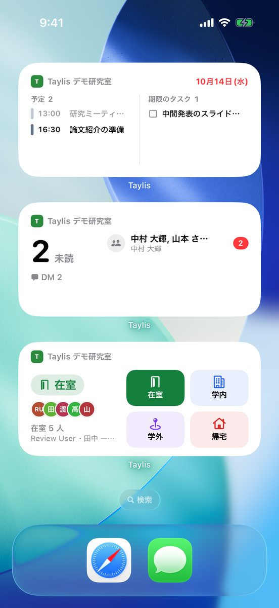
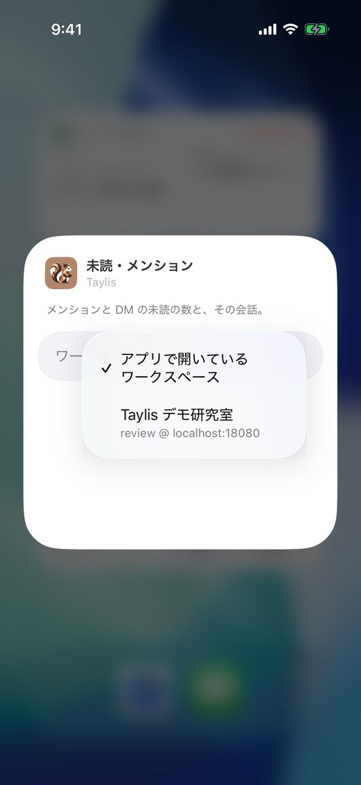
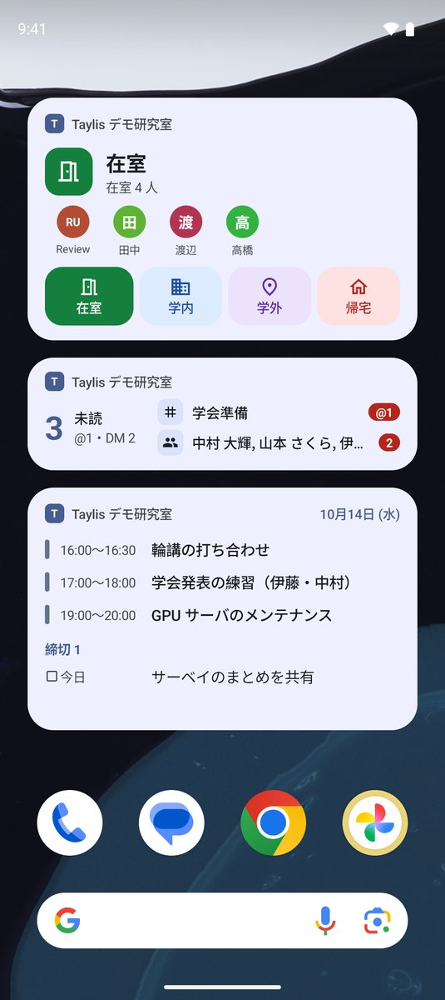

# ホーム画面のウィジェット

iPhone / iPad と Android のホーム画面に、Taylis のウィジェットを置けます。アプリを開かなくても、在室状況の切り替え、
未読とメンションの数、今日の予定と締切がひと目で分かります。

{ .phone }

## ウィジェットの種類

| ウィジェット | 出すもの | 押したとき |
| --- | --- | --- |
| **在室状況** | 自分の状態（アプリと同じ色とアイコン）と、在室の人の数と顔 | ボタンで状態を切り替える（小さいときは「在室」と「帰宅」の 1 つ、広いときは自分の状態の先頭から並ぶ）。ほかの所はアプリの「在室状況」を開く |
| **未読・メンション** | アプリのアイコンのバッジと同じ数と、その内訳（メンション・DM）。広いときは会話の名前と数 | 会話の行はその会話を開く。ほかの所はアプリを開く |
| **今日の予定・締切** | 今日の予定（終日のものが先、次に時刻順）と、今日が期限か期限切れの自分のタスク（期限切れは赤） | 予定・タスクの行はそれを開く。ほかの所はカレンダーを開く |

- 在室状況のウィジェットは、管理者が [在室状況](attendance.md) を有効にしたワークスペースで使えます。ボタンで変えたとき、
  メモは今と同じ状態を押したときだけ残ります（アプリの 1 タップと同じ）。
- 未読・メンションのウィジェットは **本文を出しません**（会話の名前と数だけ）。数の数え方は [アクティビティと未読](activity.md) の
  バッジと同じです。
- 大きさは、iPhone は小・中（今日の予定・締切は大も）とロック画面、Android は 2×1 から 4×2（今日の予定・締切は 4×3 まで）。
  大きさによって出す量が変わります。
- 中身はアプリが同期するたびと、決まった間隔で新しくなります。電波のないときは、最後に読んだ内容のままです。

## iPhone / iPad に置く

1. ホーム画面の何もない所を長押しして、アイコンが揺れ始めたら左上の「編集」→「ウィジェットを追加」を押します
   （iOS 17 では左上の ＋）。
2. 一覧から **Taylis** を選びます（上の検索欄で「Taylis」と入れても探せます）。
3. 左右にスワイプして、ウィジェットの種類と大きさを選び、「ウィジェットを追加」を押します。
4. 置きたい場所にドラッグして、右上の「完了」を押します。

ロック画面に置くときは、ロック画面を長押し →「カスタマイズ」→「ロック画面」→ ウィジェットの枠から Taylis を選びます。
iOS 18 以降は、コントロールセンターに「在室と帰宅を切り替える」ボタンも置けます。

### ワークスペースを選ぶ（iPhone / iPad）

ウィジェットごとに、どのワークスペースの内容を出すかを選べます。既定は **「アプリで開いているワークスペース」** で、
アプリでワークスペースを切り替えるとウィジェットも切り替わります。

{ .phone }

1. ホーム画面のウィジェットを長押しして、「ウィジェットを編集」を押します。
2. 「ワークスペース」を押して、出したいワークスペースを選びます。
3. ウィジェットの外を押して閉じます。

選べるのはサインイン中のワークスペースです。選んだワークスペースからサインアウトすると、ウィジェットは
「サインインしてください」と出します。

## Android に置く

1. ホーム画面の何もない所を長押しして、「ウィジェット」を押します。
2. 一覧から **Taylis** を開き、置きたいウィジェット（在室状況・未読・メンション・今日の予定・締切）を長押しして、
   ホーム画面の置きたい場所までドラッグします。
3. 「ウィジェットのワークスペース」の画面が出たら、ワークスペースを選びます（下）。
4. 大きさは、ウィジェットを長押しして出る枠をドラッグして変えられます。

ホーム画面のアプリ（ランチャー）によって、メニューの名前や手順が少し違うことがあります。

{ .phone }

### ワークスペースを選ぶ（Android）

置いたときに出る「ウィジェットのワークスペース」の画面で選びます。既定は **「アプリで開いているワークスペース」** で、
アプリでワークスペースを切り替えるとウィジェットも切り替わります。あとで変えるときは、ウィジェットを長押しして
「ウィジェットの設定」（鉛筆のアイコンのこともあります）を押します。

選んだワークスペースからサインアウトすると、そのウィジェットは「アプリで開いているワークスペース」に戻ります。

## うまく出ないとき

- **「サインインしてください」と出る**：そのワークスペースにアプリでサインインし直すか、ウィジェットのワークスペースを
  選び直してください。
- **「在室状況はオフです」と出る**：そのワークスペースで在室状況が使われていません（管理者が有効にすると出ます）。
- **「更新できません」と出る**：サーバーにつながりませんでした。電波のある所で、アプリを一度開くと新しくなります。
- **数がアプリと違う**：ウィジェットは少し遅れて新しくなります。アプリを開くと、その時点の数にそろいます。
