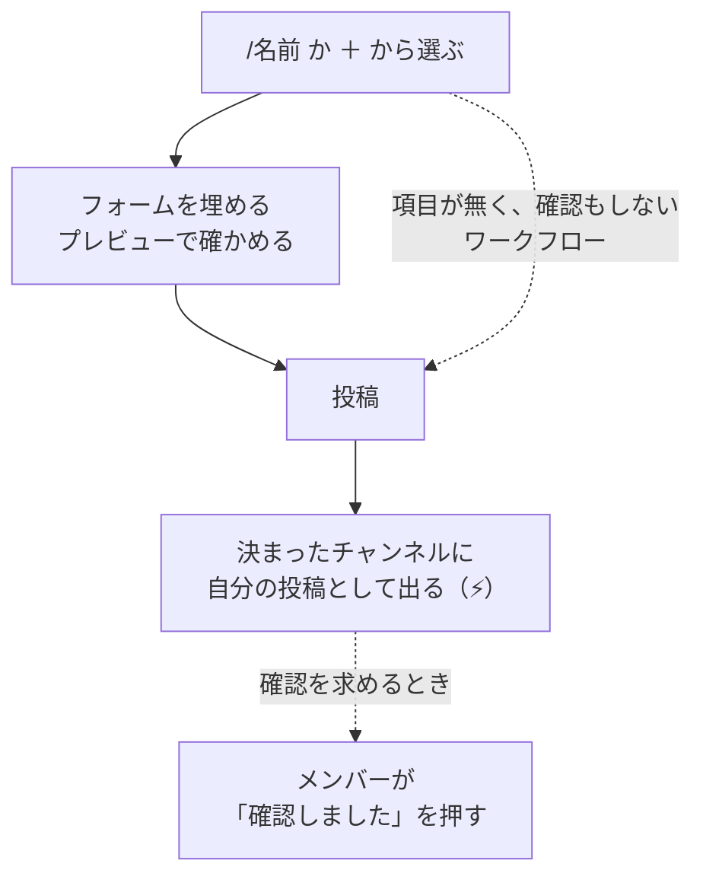
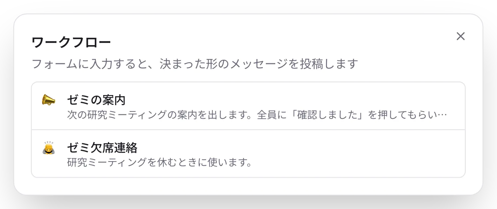
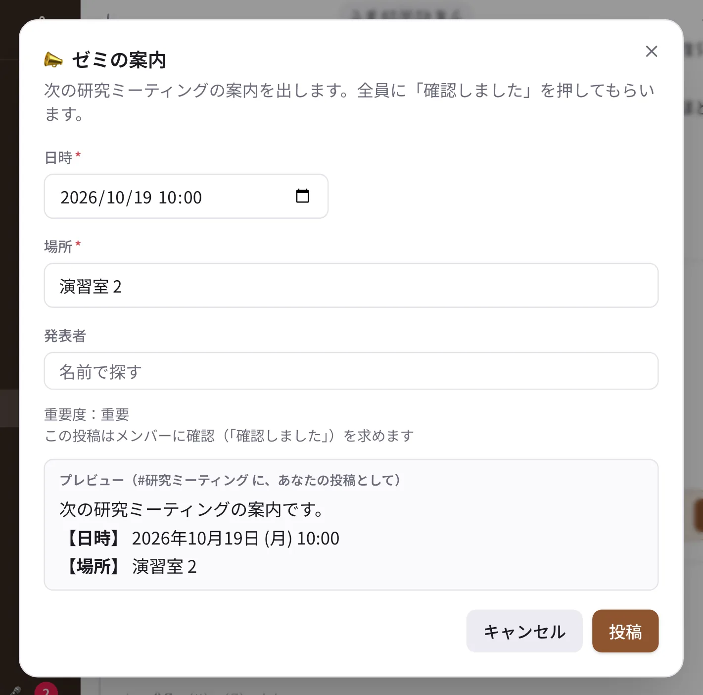
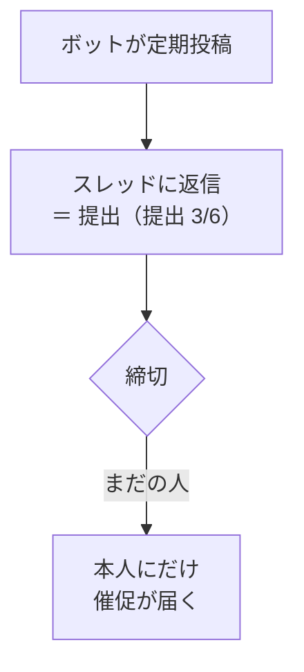

# ワークフローと定期投稿

決まった形の投稿を手で書かなくて済むようにする機能です。

| 機能 | 使いどころ | 作る人 |
| --- | --- | --- |
| ワークフロー | ゼミの欠席連絡、書誌情報の報告、ゼミの案内 | チャンネルのオーナーと管理者 |
| 定期投稿 | 毎週月曜の「週報」スレッド、毎月の連絡 | チャンネルのオーナーと管理者 |
| テンプレート | 日報・週報などの書き出し | 自分（ワークスペース共通のものは管理者） |
| フィード | ブログやニュースの RSS / Atom の新着 | チャンネルのメンバー（ゲストを除く） |

## ワークフローで報告する

1. 入力欄で `/` を打ち、ワークフローの名前（例：`/ゼミ欠席連絡`）を選びます。入力欄の ＋ →「ワークフロー…」や、チャンネルの
   ⋯ →「ワークフロー…」からも選べます。
2. 出てきたフォームの項目（日付・選択肢・人など）を埋めます。下のプレビューで、投稿される文を確かめられます。
3. 「投稿」を押すと、決まった形のメッセージが決まったチャンネルに、自分の投稿として出ます。

{ .half }
{ .half }

- チェックボックスの項目は、オンなら「はい」、オフなら「いいえ」として投稿に入ります（見出しの横に「（投稿では「はい」）」と出ます）。
- 確認を求めるワークフローでは、フォームに「この投稿はメンバーに確認（「確認しました」）を求めます」と出て、投稿には
  ふつうの「確認を求める」投稿と同じく「確認しました」のボタンが付きます。重要度（重要・緊急）が決まっているワークフローは
  「重要度：重要」なども出ます。
- 作った人が「実行するときに確認する」をオフにした、項目の無いワークフローは、選ぶとすぐに投稿されます（フォームは出ません）。
- ワークフローで出した投稿には「⚡ ワークフローの名前」の印が付きます。押すと、そのワークフローのフォームが開きます
  （すぐに投稿はされません）。

ワークフローの作り方は [チャンネル（管理者）](../admin/channels.md#workflows) をご覧ください。

## 定期投稿と提出の回収

毎週・毎月決まった時刻に、ボットがチャンネルに投稿します。**提出の回収** を付けると、その投稿へのスレッドの返信が提出になり、
「提出 3/6」のように状況が分かります。締切を過ぎると、まだの人にだけ催促が届きます。

1. チャンネルの ⋯ →「定期投稿…」→「定期投稿を追加」を選びます（チャンネルのオーナーと管理者）。
2. 本文・曜日（または日）・時刻を決めます。
3. 回収するなら、提出する人と締切（「当日」「2 日後」など）を選んで保存します。

提出する人は、投稿のスレッドに返信するだけです。

## テンプレート

入力欄の ＋ →「テンプレート…」か、`/日報` のように `/名前` で、登録した文を入力欄に入れます。自分のテンプレートは
設定 →「入力」で作れます。

## フィード（RSS / Atom）

チャンネルの ⋯ →「フィード…」でブログなどのフィードの URL を登録すると、新しい記事をボットがチャンネルに投稿します。
各自の週報ブログをまとめて流す、といった使い方ができます。
