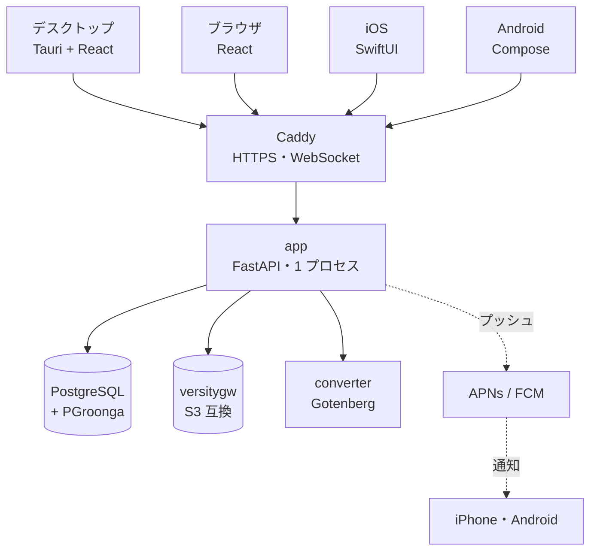
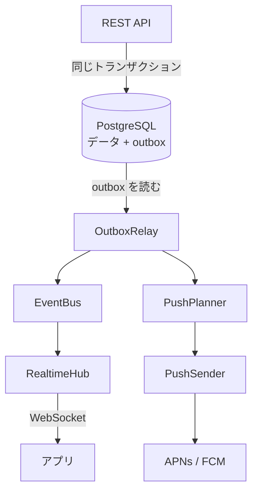

# 仕組み

Taylis の中身が気になる管理者や開発者のための、設計の要約です。詳しい設計の文書（ほとんど日本語）は
GitHub の [docs/](https://github.com/kanotown/taylis/tree/main/docs) にあります。

## 目指していること

1. メッセージを確実に保存する
2. 端末の間で確実に同期する
3. 通知を確実に届ける（ただし、通知に頼らなくても正しく動く）
4. 長い期間の履歴を、日本語と英語で探せる
5. バックアップと復元がかんたん
6. 余計な複雑さのない、保守しやすい構成

規模の目安は **数十人・数百の同時接続・数十万〜数百万件のメッセージ** です。マイクロサービスや Kubernetes は使わず、
1 つのアプリ（モジュラーモノリス）で作っています。

## 全体の構成

アプリはどれも Caddy を通して 1 つのサーバ（app）とやり取りします。データは PostgreSQL（メッセージ・検索の索引など）と
versitygw（添付ファイルの中身）の 2 か所に置きます。スマートフォンへのプッシュは、サーバから APNs と FCM を経由して届きます。

サーバの中では、API・WebSocket・送信待ちの表（outbox）の処理・プッシュの送信が 1 つのプロセスで動いています。

| 部分 | 技術 |
| --- | --- |
| サーバ | Python、FastAPI、SQLAlchemy、Alembic（移行） |
| データベース | PostgreSQL 17 と PGroonga（全文検索） |
| 添付ファイル | S3 互換のオブジェクトストレージ（既定は versitygw）。`BlobStore` の抽象の後ろにあり、ほかの S3 互換のものに替えられます |
| リアルタイム | WebSocket。イベントの配り方は `EventBus` の抽象の後ろにあり、今はメモリの中の実装です（横に増やすときは Redis などに替えられます） |
| 通知 | APNs（iOS）、FCM（Android）。`PushProvider` の抽象の後ろ |
| デスクトップ / ブラウザ | Tauri 2、React、TypeScript（同じ画面をブラウザ版としても配信） |
| iOS | Swift、SwiftUI、Swift Concurrency |
| Android | Kotlin、Jetpack Compose、Coroutines / Flow |

どのアプリも、同じ API の仕様（[openapi/openapi.json](https://github.com/kanotown/taylis/blob/main/openapi/openapi.json)）
でサーバとやり取りします。アプリごとに違う動きを作らないようにしています。

## 使わないもの

Redis、Kafka、RabbitMQ、Elasticsearch、Kubernetes、分散データベースは使いません。この規模では PostgreSQL 1 台で
十分で、部品が少ないほど壊れにくく、バックアップも簡単だからです。将来、横に増やす必要が出たときに替えられるように、
境目（EventBus、BlobStore、PushProvider）だけを決めてあります。

## もっと詳しく

- [同期と信頼性](sync.md)：メッセージの順番、重複しない送信、再接続
- [プッシュ通知の設計](push.md)：通知は合図であって、同期の手段ではない
- [検索](search.md)：PGroonga による日本語と英語の全文検索
- [セキュリティ](security.md)：認証、権限、添付ファイル
- [データモデル](data-model.md)：主な表
- 設計の文書：[ARCHITECTURE.md](https://github.com/kanotown/taylis/blob/main/docs/ARCHITECTURE.md)
