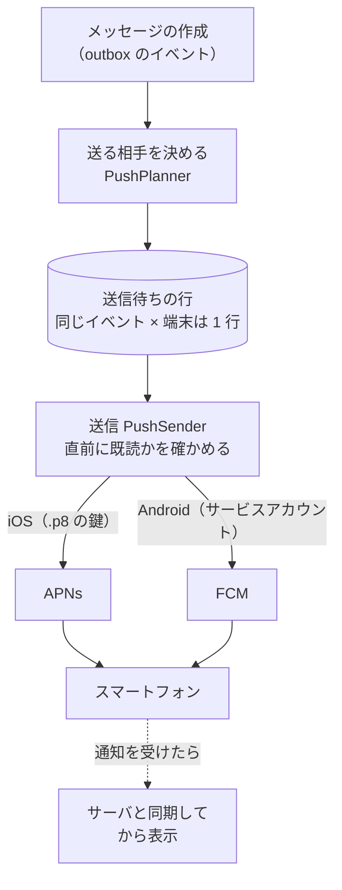

# プッシュ通知の設計

## プッシュは「合図」

Taylis では、プッシュ通知は **「新しいデータがあるかもしれない」という合図** で、同期の手段ではありません。
通知が遅れる・重複する・順番が入れ替わる・届かない、のどれが起きても、システムは正しく動きます。
通知を受け取ったアプリは、サーバと同期してから内容を表示します。

## 流れ

- 送信待ちの行はデータベースに残るので、送信中にサーバが落ちても、再起動の後に続きから送ります。
- 同じ通知が 2 回送られても、端末の側で 1 つにまとめます（collapse）。
- プロバイダの違いは `PushProvider` の実装（APNs / FCM）に閉じ込めています。
- デスクトップ版はプッシュを使わず、WebSocket のイベントからアプリが OS の通知を出します。

## 送らない場面

| 場面 | 理由 |
| --- | --- |
| 自分の投稿 | 自分には知らせない |
| 別の端末で使っている間 | パソコンで読んでいるときにスマートフォンを鳴らさない |
| すでに既読 | 送る直前にも確かめる |
| 通知のレベルが「なし」・ミュート・一時停止・おやすみ時間 | 本人の設定 |
| 参加していないスレッドの返信 | フォローしている人とメンションされた人だけ |
| ブロックしている相手から | 本人の設定 |
| 参加・退出の 1 行 | 知らせる必要がない |
| 古すぎる通知 | 期限を過ぎたものは送らない |

## 通知が届かなくても困らない理由

- アプリは起動のとき・前面に戻ったときに必ずサーバと同期します。
- 未読はサーバに残っているので、通知が届かなかったメッセージも失われません。
- 無効になったトークン（アプリを消した端末など）は自動で消し、アプリが開かれたときに登録し直します。

## 通知の内容

通知の本文にはメッセージの抜粋が入ります。サーバの設定 `PUSH_INCLUDE_CONTENT=false` にすると、本文を入れず
「新しいメッセージがあります」のような文だけにできます（APNs や FCM に本文を渡したくない場合）。

詳しくは [docs/PUSH_NOTIFICATIONS.md](https://github.com/kanotown/taylis/blob/main/docs/PUSH_NOTIFICATIONS.md) をご覧ください。
