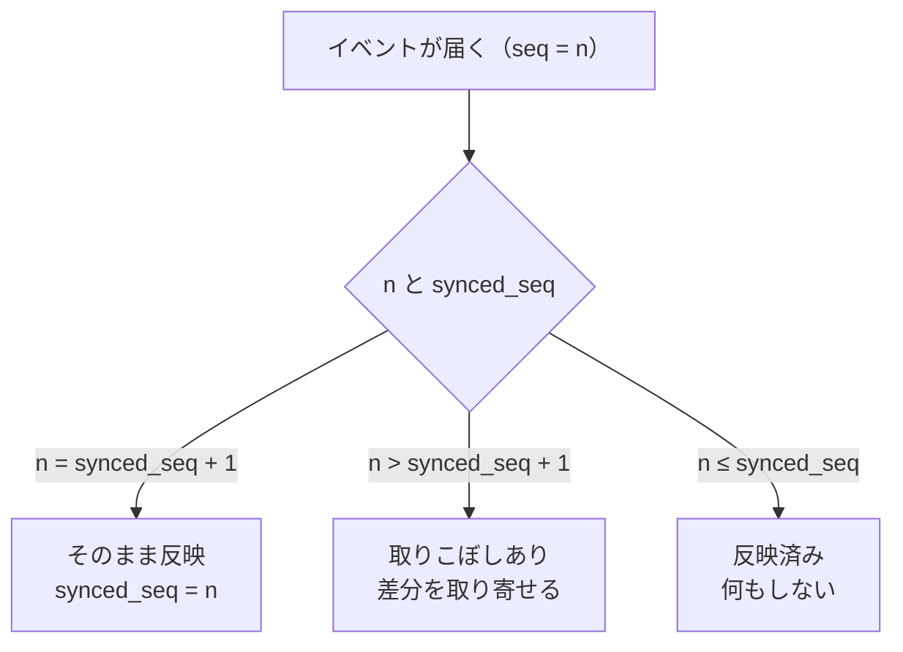
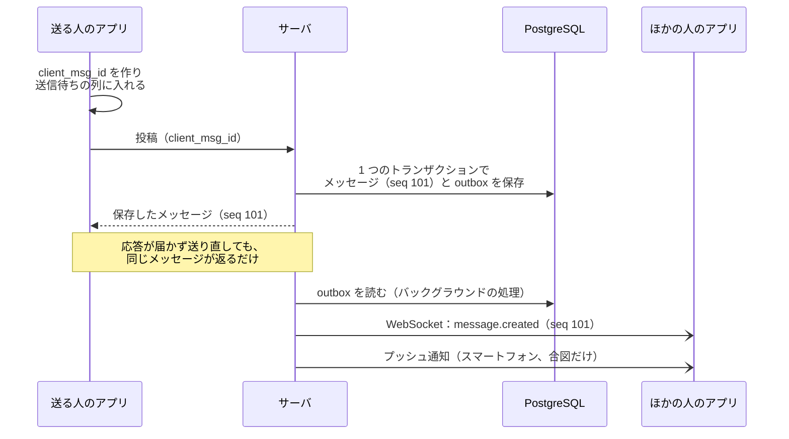
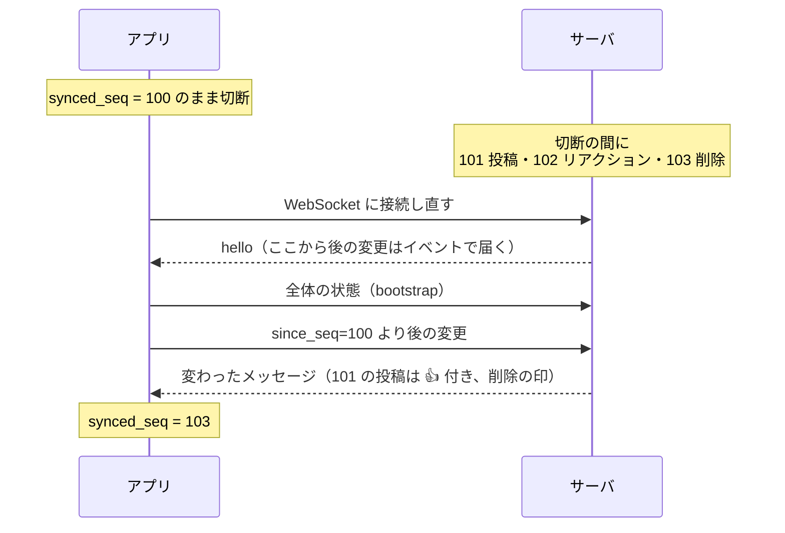

# 同期と信頼性

Taylis の設計でいちばん重視しているのは、**メッセージを失わず、重複させず、どの端末でも同じ順番で表示する** ことです。
このページでは、そのための仕組みを説明します。

## 原則

1. **サーバが正しい状態を持つ**。アプリの画面は、サーバから受け取った内容を端末のデータベースに入れてから描きます。
2. **REST が本体、WebSocket は合図**。WebSocket で受け取れる情報は、すべて REST でも取得できます。WebSocket の
   イベントが届かなくても、後から取り戻せます。
3. **プッシュ通知も合図**。通知を受け取ったら、アプリはサーバと同期します。通知の中身を表示の根拠にはしません。

## 順番：チャンネルごとの連番（seq）

メッセージの並び順は、端末の時計ではなく、サーバがチャンネルごとに振る **連番（seq）** で決めます。

- メッセージの作成・編集・削除、リアクションの追加と削除のたびに、そのチャンネルの seq を 1 つ進めます。
- seq は隙間なく 1, 2, 3, … と続きます（データベースの 1 つの更新で採番するので、コミットの順と seq の順が一致します）。
- **seq を 1 つ進めるたびに、その seq を持つイベントがちょうど 1 つ作られます**。アプリは届いたイベントの seq が
  飛んでいれば、取りこぼしに気づけます。

WebSocket でイベントを受け取ったアプリは、自分の持っている seq（`synced_seq`）と比べて次のように扱います。

## 重複しない送信（冪等性）

アプリはメッセージを送る前に、ランダムな ID（`client_msg_id`）を作ります。

- サーバは「送った人 + client_msg_id」を一意にしているので、通信が切れて同じメッセージを何度送り直しても、
  サーバに保存されるのは 1 つだけです。
- 送信中のメッセージは、端末の送信待ちの列に保存されます。アプリを閉じても、次に開いたときに送り直します。
- 画面には送信中のメッセージをすぐに出し、サーバの応答（seq の付いた本物）が来たら置き換えます。

## 通知を失わない：トランザクショナル・アウトボックス

メッセージを保存するときは、同じ PostgreSQL のトランザクションの中で、

1. メッセージを保存し、
2. 「メッセージができた」というイベント（outbox）を保存してから、

コミットします。バックグラウンドの処理が outbox を読んで、WebSocket で配り、プッシュ通知を計画します。
メッセージのコミットの直後にサーバが落ちても、イベントはデータベースに残っているので、再起動の後に処理されます。
処理は何度実行しても結果が同じ（冪等）になるように作っています。この仕組みは PostgreSQL だけで動いていて、
Kafka や RabbitMQ は使っていません。

メッセージを送ってから、ほかの人の画面に出るまでの流れです。

## 再接続：足りない分を取り寄せる

アプリはチャンネルごとに「この seq までは反映済み」というカーソルを覚えています。

- 起動したとき・WebSocket がつながり直したとき・スリープから戻ったとき・プッシュを受け取ったときに、
  サーバにカーソルより後の変更を問い合わせ、足りない分を取り寄せます。
- 通信が一時的に切れた・アプリが止められた・端末を再起動した・プッシュが届かなかった、のどれでも同じ手順で回復します。
- 同じイベントを何度受け取っても、端末の状態は同じになります（新しい `updated_seq` のときだけ上書き）。

たとえば、切断している間に 3 件の変更があった場合は次のようになります。

イベントを 1 つずつ再生するのではなく、「変わったメッセージの今の状態」をまとめて受け取ります。

## 既読の同期

既読は「メッセージ 1 件ごと」ではなく、「人 × チャンネルごとに、どこまで読んだか（last_read_seq）」の 1 行で持ちます。

- 未読の数は、チャンネルの seq と既読の位置から計算できます。
- 読んだときの既読の位置は前にしか進まないので、複数の端末で読んでも同じ値に収束します。パソコンで読んだ分は、スマートフォンでも
  既読になります。位置を後ろに戻すのは「ここから未読にする」だけで、これもほかの端末に伝わります。

## 保証すること・しないこと

| 保証する | 保証しない |
| --- | --- |
| 同じチャンネルの中の順番は seq で一意に決まる | WebSocket のイベントが必ず届くこと（取り寄せで補います） |
| 切断の間の変更は、再接続の後にすべて回復できる | チャンネルをまたいだ順番 |
| 同じ送信を何度送り直しても、メッセージは 1 つ | 端末の時計とサーバの時計が合っていること |
| 既読の位置は複数の端末で同じ値に収束する | |

詳しくは [docs/SYNC_PROTOCOL.md](https://github.com/kanotown/taylis/blob/main/docs/SYNC_PROTOCOL.md) と
[docs/DATA_MODEL.md](https://github.com/kanotown/taylis/blob/main/docs/DATA_MODEL.md) の「ID とシーケンスの役割」を
ご覧ください。
