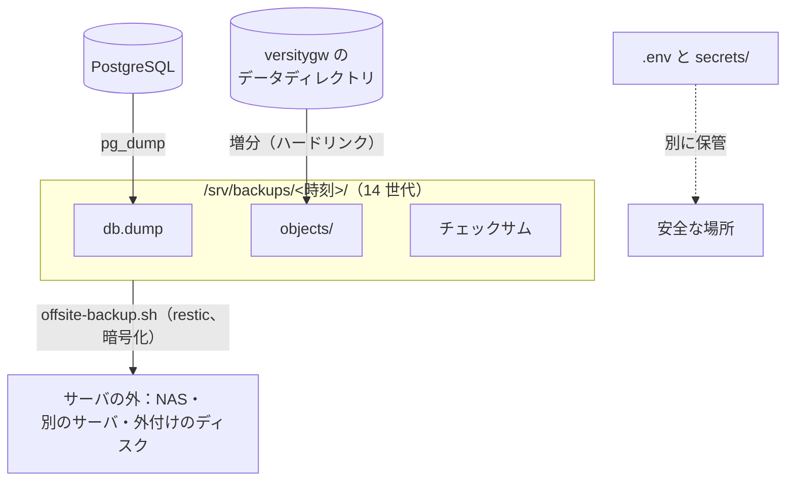

# バックアップと復元

Taylis のデータは **PostgreSQL** と **オブジェクトストレージ（versitygw）のデータディレクトリ** の 2 か所だけです。
付属のスクリプトが、この 2 つをまとめてバックアップします。



## 毎日のバックアップ

`infra/backup.sh` は、データベースを `pg_dump` で書き出した後に、添付ファイルを写します。cron で毎日動かします。

```sh
# crontab (root)
30 3 * * * CHIKUWA_PROD=1 /srv/chikuwachat/infra/backup.sh /srv/backups >> /var/log/chikuwachat-backup.log 2>&1
```

- `/srv/backups/<UTC の時刻>/` に `db.dump`・`objects/`・チェックサムができます。
- **14 世代** を残します（更新の直前に取るバックアップも 1 世代に数えます）。
- `objects/` は **増分** です。前回から変わっていないファイルは前回のバックアップへのハードリンクになり、チェックサムも
  前回のものを引き継ぐので、添付とドライブで 100 GB あっても、14 世代で 100 GB と毎日の増えた分、変わらない夜は数秒で済みます。
  `BACKUP_VERIFY=1` を付けて動かすと（週に一度など）、すべてのファイルを読み直してチェックサムと比べます。
- バックアップは 1 つのファイルシステムの中に置きます。サーバの外へは、次の `offsite-backup.sh` で送ってください。

!!! danger "`.env` と `secrets/` は別に保管する"
    バックアップには `.env`（秘密の値）と `secrets/`（APNs / FCM の鍵など）は入りません。安全な別の場所に控えてください。

## サーバの外へのバックアップ { #offsite }

サーバの中の世代は、消したファイルを昨日に戻すためのもので、ディスクの故障やサーバの喪失には効きません。
`infra/offsite-backup.sh` は、一番新しいバックアップを [restic](https://restic.net/) で **サーバの外** へ送ります
（暗号化・重複排除・増分。restic は Docker のイメージで動くので、サーバに入れるものはありません）。
[ドライブ](../admin/drive.md#backup) を使うなら必須です。

送り先は `infra/offsite.conf`（`offsite.conf.example` を写して書く。リポジトリには入りません）で選びます。

| 送り先 | 書き方 |
| --- | --- |
| SSH で入れる別の機械（大学の NAS・別のサーバ） | `RESTIC_REPOSITORY=sftp:ユーザー@ホスト:/パス`（この用途だけの鍵と、相手のホスト鍵を用意） |
| サーバにつないだディスク・NAS の共有 | `RESTIC_REPOSITORY=/mnt/offsite/taylis-restic` |

```sh
cd /srv/chikuwachat/infra
cp offsite.conf.example offsite.conf && chmod 600 offsite.conf
openssl rand -base64 32 > secrets/restic-password && chmod 600 secrets/restic-password
./offsite-backup.sh init
./offsite-backup.sh backup
# crontab (root): 毎晩 backup.sh の後に送り、週に一度 古いものを整理して一部を読み戻す
30 4 * * * /srv/chikuwachat/infra/offsite-backup.sh backup >> /var/log/chikuwachat-offsite.log 2>&1
30 5 * * 0 /srv/chikuwachat/infra/offsite-backup.sh maintain >> /var/log/chikuwachat-offsite.log 2>&1
```

- **restic のパスワード（`secrets/restic-password`）はサーバの外にも控えてください。** 無いとバックアップは読めません。
- 残すのは 14 日・8 週・12 か月分です。`maintain` は整理と、データの 5% の読み戻し（`check`）をします。
- `OFFSITE_INCLUDE_SECRETS=1` にすると `.env` と `secrets/` も（暗号化されて）入ります。
- **別の機械で戻せることを確かめる**：サーバとは別の機械で `infra/offsite-rehearsal.sh` を動かすと、サーバの外から戻して使い捨ての環境に入れ、
  件数を比べて `REHEARSAL OK` を出し、片付けます。半年に一度と、Nextcloud を止める前には必ず。

## 復元

`infra/restore.sh` は、データベース → 添付ファイル → アプリの起動 → 添付ファイルの検査 の順に戻します。

```sh
cd /srv/chikuwachat/infra
CHIKUWA_PROD=1 ./restore.sh /srv/backups/20260926T033000Z
```

- 今のデータベースと添付ファイルを **置き換えます**。
- 復元の後、`verify-attachments` がデータベースにあって実物の無い添付ファイルを報告します（ふつうは 0 件です）。

## 復元のリハーサル

`infra/restore-rehearsal.sh` は、動いているサーバからバックアップを取り、別の compose プロジェクトに復元して、
ユーザー・メッセージ・添付ファイルの件数を比べてから片付けます。今のサーバには触れません。
**四半期に一度** は実行して、本当に戻せることを確かめてください。同じディスクにもう 1 組を作るので、ドライブが大きいときは、
サーバの外から別の機械で戻す `offsite-rehearsal.sh`（上）を使ってください。

## 運用のコマンド

`docker compose ... exec app python -m app.cli <コマンド>` で使います。

| コマンド | 用途 |
| --- | --- |
| `create-admin` / `create-user` | アカウントの作成（仮のパスワードは一度だけ表示） |
| `push-test --user <名前>` | プッシュ通知の疎通の確認 |
| `verify-attachments` | 添付ファイルの実物の欠けを報告 |
| `anonymize-user --username <名前>` | 退会：名前・メール・ログイン情報・端末を消し、履歴は「退会したユーザー」で残す |
| `export-channel --channel <名前> --out <ファイル.jsonl>` | チャンネルの履歴を JSONL で書き出す（添付はメタデータのみ） |
| `generate-previews` | 古い文書のプレビューを作る |
| `import-emoji-presets` | サーバのフォルダの絵文字のセットを取り込む |

古いセッション（30 日）、無効にした端末（90 日）などは、サーバが自動で掃除します。
