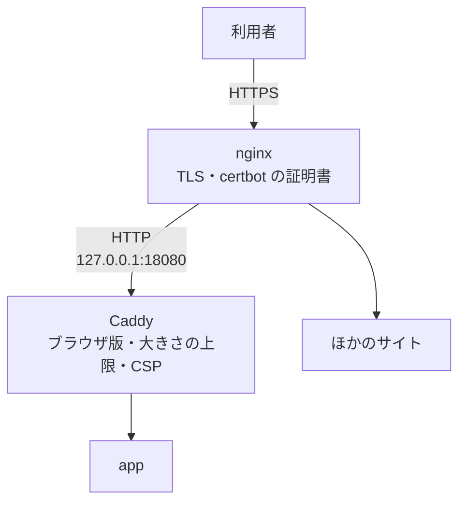

# 既存のリバースプロキシの後ろで

ほかのサイトの nginx がすでに 80 / 443 と証明書（certbot）を持っているサーバでは、Caddy に 80 / 443 を渡さず、
nginx の後ろで動かします。



## 1. Caddy をローカルのポートだけで動かす

compose に `docker-compose.behind-proxy.yml` を足します。Caddy は `127.0.0.1:18080` の HTTP だけを受けます
（ポートは `.env` の `BEHIND_PROXY_PORT` で変えられます）。

```sh
docker compose -f docker-compose.yml -f docker-compose.prod.yml -f docker-compose.behind-proxy.yml \
  --profile proxy up -d --build
```

!!! warning "いつも `-f docker-compose.behind-proxy.yml` を付ける"
    付けずに Caddy を起動すると、Caddy が 80 / 443 を取りに行って nginx とぶつかり、起動しません。
    自動デプロイを使うときは `deploy.conf` の `EXTRA_COMPOSE_FILES=docker-compose.behind-proxy.yml` で付きます
    （初期設定のスクリプトの `--behind-proxy`）。

## 2. nginx のサイトを作る

リポジトリの [infra/nginx-site.conf.example](https://github.com/kanotown/taylis/blob/main/infra/nginx-site.conf.example)
から作り、`chat.example.com` を自分のドメインに置き換えます。証明書は certbot で取ります。

```sh
cp nginx-site.conf.example /etc/nginx/sites-available/chikuwachat   # chat.example.com を置き換える
ln -s /etc/nginx/sites-available/chikuwachat /etc/nginx/sites-enabled/
nginx -t && systemctl reload nginx
certbot --nginx -d chat.example.com --redirect
```

この設定例では次の設定をしています。ほかのリバースプロキシを使うときも、同じ設定が必要です。

- `X-Forwarded-For` を接続元のアドレスで **置き換え**、`X-Forwarded-Proto` を渡す（Caddy はこの構成でだけ、
  プライベートアドレスからの転送ヘッダを信用します）。
- WebSocket のために `Upgrade` と `Connection` を通す。
- 読み取りのタイムアウトを長く（1 時間）する。WebSocket の接続を切らないためです。
- アップロードの上限（`client_max_body_size`）を、添付ファイルの上限（既定 100 MB）より大きくする。絵文字セットの
  取り込み（ZIP かフォルダーで合計 64 MB まで）もこの上限の内側に入ります。パスごとの正確な上限（添付 110 MB、
  絵文字セット 70 MB、プロフィール画像 6 MB、それ以外の API は 1 MB）は、後ろの Caddy が受け持ちます。

### アクセスログ { #access-log }

ドライブの外部共有リンク（`/s/<トークン>`、`/api/v1/shares/<トークン>/…`）・招待リンク・カレンダーの購読 URL などは、URL の
パスに鍵が入っています。nginx の既定のアクセスログはそれをそのまま何週間も残すので、設定例では **伏せた形式のログ** を使っています：
`map $uri $chikuwachat_log_uri { … }` と `log_format chikuwachat_masked …` を `server` の外に、
`access_log /var/log/nginx/access.log chikuwachat_masked;` を `server` の中に置きます。ログには `GET /s/*** …` のように残り、
クエリ文字列は書きません。すでに動いているサーバでは、この 3 か所を今のサイトの設定に足して `nginx -t && systemctl reload nginx`
してください。`error_log` は書式を変えられず、上流（Caddy）につながらないときにリクエストの行・上流の URL・Referer を
そのまま書きます。`/var/log/nginx` は root と adm だけが読めるままにするか、設定例のコメントの
`error_log /var/log/nginx/chikuwachat-error.log crit;` を有効にしてください（上流のエラーは書かれなくなります）。
Caddy 自身のエラーログは、同梱の Caddyfile がトークンを `***` にしてから書きます。

## TLS について

本番では TLS が必須です。Caddy を表に出す構成（[クイックスタート](quickstart.md)）では、Caddy が Let's Encrypt
などから証明書を自動で取って更新します。nginx の後ろの構成では、nginx（certbot）が TLS を受け持ちます。
