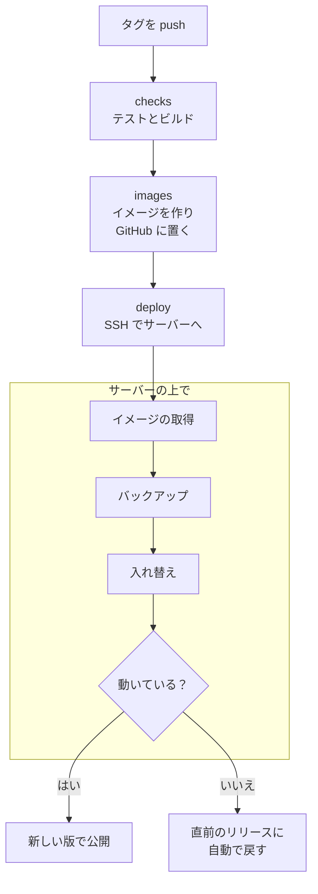

# 更新と自動デプロイ

## 手で更新する

[クイックスタート](quickstart.md) の手順で立てたサーバーは、次のように更新します。**更新の前にバックアップを
取ってください。**

```sh
cd /srv/chikuwachat/infra
CHIKUWA_PROD=1 ./backup.sh /srv/backups
git pull
docker compose -f docker-compose.yml -f docker-compose.prod.yml --profile proxy up -d --build
```

- データベースの移行は、アプリの起動のときに自動で適用されます。
- 切り替えの間、数秒だけ API が止まります。アプリは自動で再接続し、足りない分を取り寄せます。
- 後方互換のない変更があるときは、リリースノートに書きます。

## タグから自動でデプロイする（GitHub Actions）

自分のリポジトリ（フォーク）で `v1.2.3` の形のタグを push すると、GitHub Actions がテスト → イメージの作成 →
サーバーへのデプロイまでを自動で実行します（`.github/workflows/release.yml`）。

```sh
git tag v1.2.3 && git push origin v1.2.3
```



- 秘密の値（`.env`、`secrets/`）はサーバーにだけ置き、GitHub には SSH の接続情報だけを置きます。
- サーバーの初期設定は `infra/vps-bootstrap.sh` が行います（Docker、`deploy` ユーザー、デプロイ用の鍵の登録、
  `.env` のランダムな値、毎日のバックアップの cron）。
- 前のリリースに戻すときは、Actions の release を、戻したいタグを選んで手で実行します。

準備の手順（VPS・DNS・初期設定・GitHub の Environment と Secrets・最初のリリース）は
[infra/README.md の「自動デプロイ」](https://github.com/kanotown/taylis/blob/main/infra/README.md) に詳しく書いてあります。

## デスクトップ版の更新

公式のデスクトップ版は、起動のときと 6 時間ごとに新しい版を確かめ、右下に「新しい版があります」と出します。
「更新して再起動」で更新できます。設定の「このアプリについて」からも確かめられます。
配布物は [GitHub のリリース（kanotown/taylis）](https://github.com/kanotown/taylis/releases/latest) にあります。

ブラウザ版は、サーバーを更新すると新しい版になります。スマートフォンのアプリは、ストアから更新します（準備中）。

## サーバーとアプリの版

アプリとサーバーは同じ API の仕様（[openapi/openapi.json](https://github.com/kanotown/taylis/blob/main/openapi/openapi.json)）
でやり取りします。新しい機能は、古いアプリが動かなくならないように（知らない項目は無視されるように）追加しています。
それでも、サーバーとアプリはなるべく新しい版にそろえてください。
