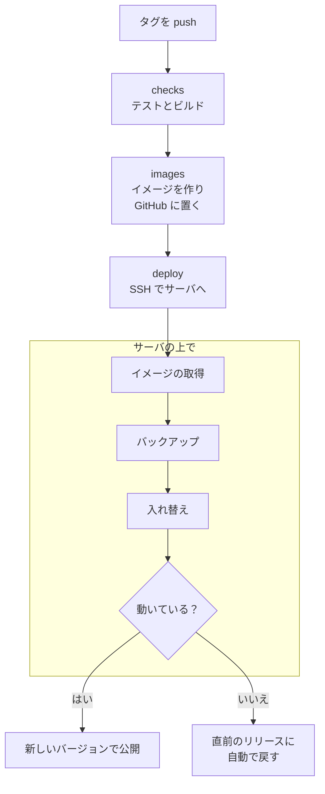

# 更新と自動デプロイ

## 手で更新する

[クイックスタート](quickstart.md) の手順で立てたサーバは、次のように更新します。**更新の前にバックアップを
取ってください。**

```sh
cd /srv/chikuwachat/infra
CHIKUWA_PROD=1 ./backup.sh /srv/backups
git pull
docker compose -f docker-compose.yml -f docker-compose.prod.yml --profile proxy up -d --build
```

- データベースの移行は、アプリの起動のときに自動で適用されます。
- 切り替えの間、数秒だけ API が止まります。アプリは自動で再接続し、足りない分を取り寄せます。
- 後方互換のない変更があるときは、リリースノートに書きます。

## 更新の後に流すコマンド { #after-upgrade }

ほとんどの更新は、上の手順だけで済みます。前からあるデータに新しい機能を当てるときだけ、サーバの `infra` のフォルダでコマンドを
流します（どれも何度流してもよく、止めても続きから流せます）。

| 上げたバージョン | 流すもの | 内容 |
| --- | --- | --- |
| v0.1.74 から | `drive-index --limit 500` | ドライブの Word / Excel / PowerPoint の中身を検索に入れる（[ドライブの管理](../admin/drive.md#drive-index-office)） |
| v0.1.79 から | 任意：`channel-files-backfill` | 前からのチャンネルの添付をチャンネルのドライブの「投稿のファイル」に入れる（[ドライブの管理](../admin/drive.md#channel-files-backfill)） |
| v0.1.80 から | `drive-photos --dry-run` → `drive-photos --limit 500` | 前からドライブにある写真の撮影日時と縮小版を作り、HEIC にもサムネイルを付ける（[ドライブの管理](../admin/drive.md#drive-photos)） |

```sh
docker compose -f docker-compose.yml -f docker-compose.prod.yml exec app python -m app.cli drive-photos --dry-run
```

!!! note "v0.1.80 から、サーバのイメージは Debian 13（trixie）です"
    app のイメージの土台を Debian 12（bookworm）から Debian 13（trixie）に上げました。中の ffmpeg が 5.1 から 7.1 になり、
    Mac や Android から来た HEIC の写真にもサムネイルが付きます。Python は同じ 3.13 で、データベースの移行もありません。

    - **サーバの OS は変えなくてかまいません**（Debian 12 の VPS のままで動きます。変わるのはコンテナの中だけです）。
      データベース・オブジェクトストレージ・文書の変換・Web のイメージも変わりません。
    - 土台が変わるので、上げた最初の更新では app のイメージを丸ごと（約 350 MB）取り直します。古いイメージを消すまで、ディスクを
      その分だけ多く使います（`docker image prune` で消せます）。
    - 戻すときは、前のリリースのイメージに戻すだけです（データの形は変わりません）。

## タグから自動でデプロイする（GitHub Actions）

自分のリポジトリ（フォーク）で `v1.2.3` の形のタグを push すると、GitHub Actions がテスト → イメージの作成 →
サーバへのデプロイまでを自動で実行します（`.github/workflows/release.yml`）。

```sh
git tag v1.2.3 && git push origin v1.2.3
```



- 秘密の値（`.env`、`secrets/`）はサーバにだけ置き、GitHub には SSH の接続情報だけを置きます。
- サーバの初期設定は `infra/vps-bootstrap.sh` が行います（Docker、`deploy` ユーザー、デプロイ用の鍵の登録、
  `.env` のランダムな値、毎日のバックアップの cron）。
- 前のリリースに戻すときは、Actions の release を、戻したいタグを選んで手で実行します。

準備の手順（VPS・DNS・初期設定・GitHub の Environment と Secrets・最初のリリース）は
[infra/README.md の「自動デプロイ」](https://github.com/kanotown/taylis/blob/main/infra/README.md) に詳しく書いてあります。

## デスクトップ版の更新

公式のデスクトップ版は、起動のときと 6 時間ごとに新しいバージョンを確かめ、右下に「新しいバージョンがあります」と出します。
「更新して再起動」で更新できます。設定の「このアプリについて」からも確かめられます。
配布物は [GitHub のリリース（kanotown/taylis）](https://github.com/kanotown/taylis/releases/latest) にあります。

ブラウザ版は、サーバを更新すると新しいバージョンになります。スマートフォンのアプリは、ストアから更新します（Android は Google Play。iOS は準備中）。

## サーバとアプリのバージョン

アプリとサーバは同じ API の仕様（[openapi/openapi.json](https://github.com/kanotown/taylis/blob/main/openapi/openapi.json)）
でやり取りします。新しい機能は、古いアプリが動かなくならないように（知らない項目は無視されるように）追加しています。
それでも、サーバとアプリはなるべく新しいバージョンにそろえてください。
