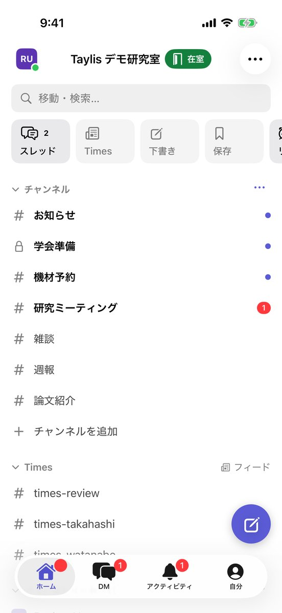
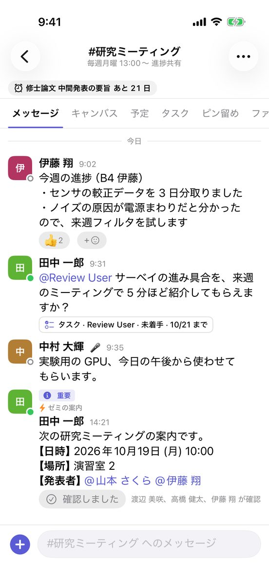
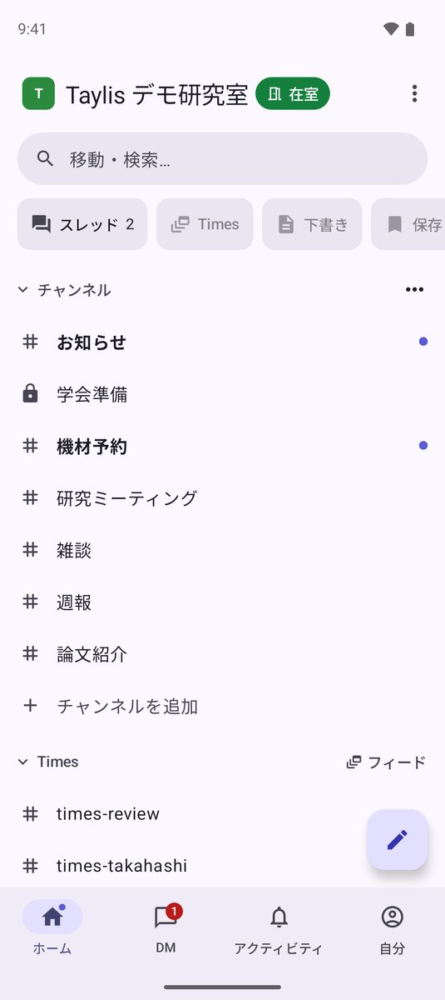
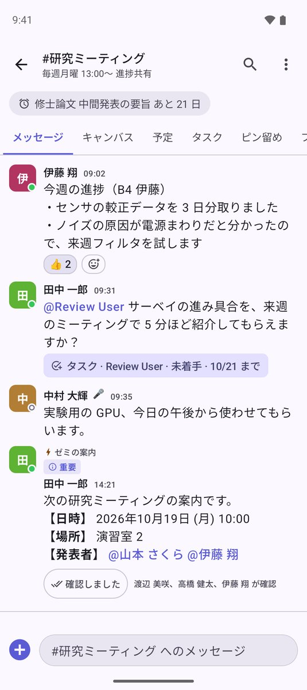

# アプリを入れる

Taylis はパソコンでもスマートフォンでも使えます。どのアプリでも、同じアカウントで同じ会話を読めます。どこまで読んだかも
端末の間でそろいます。

| アプリ | 入手方法 | 向いている使い方 |
| --- | --- | --- |
| Windows / macOS（デスクトップ版） | [GitHub のリリース](https://github.com/kanotown/taylis/releases/latest) からインストーラをダウンロード | 毎日使うパソコン。通知がいちばん確実です |
| ブラウザ版 | インストールは不要。サーバの URL をブラウザで開く | 共用のパソコン、ちょっと見るとき |
| iPhone / iPad | 準備中（App Store での配信を準備しています） | 外出先、プッシュ通知 |
| Android | [Google Play](https://play.google.com/store/apps/details?id=jp.chikuwachat.android) | 外出先、プッシュ通知 |

## デスクトップ版（Windows / macOS）

1. [GitHub のリリース](https://github.com/kanotown/taylis/releases/latest) を開きます。
2. 「Assets」から、使っているパソコンに合うファイルをダウンロードします。
    - **macOS**：`Taylis_<バージョン>_universal.dmg`（Apple シリコンと Intel のどちらでも動きます）
    - **Windows**：`Taylis_<バージョン>_x64-setup.exe`（管理者が配るときは `.msi` も使えます）
3. インストールします。
    - **macOS**：`.dmg` を開き、Taylis のアイコンを「Applications」へドラッグします。
    - **Windows**：`.exe` を開き、画面に従います。「Windows によって PC が保護されました」と出たときは、
      「詳細情報」→「実行」を選びます。
4. Taylis を開き、「サーバ URL」にサーバの URL を入れてログインします（[ログイン](../guide/login.md)）。

### 新しいバージョンへの更新

デスクトップ版は、起動したときと 6 時間ごとに新しいバージョンを確かめます。新しいバージョンがあると「新しいバージョンがあります」と出るので、
**「更新して再起動」** を押してください。設定 →「このアプリについて」→「アップデートを確認」でもすぐに確かめられます。

!!! tip "ウィンドウを閉じても通知は届きます"
    デスクトップ版は、ウィンドウを閉じても裏で動き続けて通知を出します。完全に終了するには、macOS は ++cmd+q++、
    Windows は通知領域の Taylis のアイコンを右クリックして「終了」です（[通知の設定](../guide/notifications.md)）。

## ブラウザ版

サーバの URL（例：`https://chat.example.ac.jp/`）を Chrome・Safari・Edge・Firefox で開き、ログインします。
デスクトップ版と同じ画面で、サーバが更新されると自動で新しいバージョンになります。

- 通知は、そのタブを開いている間だけ届きます。
- スマートフォンのブラウザでも使えますが、通知を受け取るにはアプリのほうが向いています。

## スマートフォン（iPhone・iPad・Android）

ストアでの配信を準備しています。配信が始まったら、ストアから入れてサーバの URL でログインします。

{ .phone }
{ .phone }
{ .phone }
{ .phone }

- 画面の下に「ホーム」「DM」「アクティビティ」「検索」「自分」の 5 つのタブがあります。設定は「自分」の中です。
- iPad と Android のタブレットでは、一覧・会話・スレッドを横に並べた広い画面になります。
- 初めてログインしたときに通知の許可を求められたら、「許可」を選んでください。

!!! note "自分たちで立てたサーバとストア版のアプリ"
    ストア版のアプリは、どの Taylis サーバにもログインできます。ただしプッシュ通知はアプリを配る人の鍵で送るため、
    自分たちで立てたサーバからストア版のアプリへのプッシュ通知は、今のところ届きません（アプリを開いている間は
    通知が出ます）。詳しくは [プッシュ通知](../self-hosting/push.md) をご覧ください。
